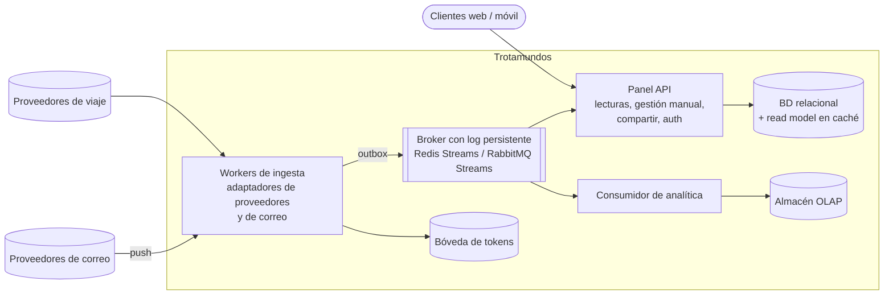

# ADR-0001: Estilo arquitectónico de Trotamundos

- **Estado:** Propuesto
- **Fecha:** 13/10/2026
- **Decisores:** Equipo de diseño (grupo TPE)
- **Drivers de entrada:** [Análisis inicial y drivers](Analisis-Inicial-y-Drivers.md) (CU-01 a CU-04, QA-1 a QA-15, R-1 a R-6, PA-1 a PA-4)

---

## 1. Contexto y problema

Hay que elegir el estilo arquitectónico general de Trotamundos antes de empezar las iteraciones de ADD. La decisión condiciona todas las demás (broker, almacenamiento, despliegue, seguridad).

El sistema no es difícil por el tráfico de lectura del panel: 2 M de usuarios activos semanales con picos ×10 se resuelven con caché y un read model. La dificultad está en cuatro puntos:

1. **Ingesta:** correo de 15 M de casillas (QA-8, QA-10, QA-11) y eventos de proveedores heterogéneos (QA-1, QA-6, QA-9) con picos impredecibles.
2. **Disponibilidad:** 99,99 % (QA-5) exige redundancia real y ausencia de puntos únicos de falla.
3. **Aislamiento:** la analítica pesada no debe degradar el panel (QA-4).
4. **Extensibilidad:** sumar trenes sin tocar el núcleo (QA-13).

Además, el TPE se evalúa por la **trazabilidad entre la arquitectura documentada y el código del prototipo**, y es un trabajo grupal con plazo acotado. La viabilidad de implementación es entonces un criterio de decisión de primer orden y no un detalle.

## 2. Criterios de decisión

| Criterio | Peso | Origen del peso |
|---|---|---|
| QA-1 (actualizaciones en 5 min) | 3 | Prioridad Alta |
| QA-2 / QA-3 (latencia del panel) | 2 | QA-2 Media, QA-3 Baja |
| QA-4 (aislar analítica) | 1 | Prioridad Baja |
| QA-5 (99,99 %) | 3 | Prioridad Alta |
| QA-6 / QA-9 (resiliencia e interoperabilidad con proveedores) | 3 | QA-9 Alta, QA-6 Media |
| QA-7 / QA-8 (escalabilidad) | 3 | QA-7 Alta, QA-8 Media |
| QA-11 / QA-12 (seguridad) | 2 | QA-11 Media, QA-12 Baja |
| QA-13 (evolucionabilidad) | 2 | Prioridad Media |
| Facilidad de implementar | 3 | Viabilidad del prototipo en el plazo del TPE |
| Trazabilidad doc ↔ código | 3 | Criterio de evaluación explícito del TPE |

Los pesos de los QA siguen la columna "Prioridad" del análisis inicial (Alta = 3, Media = 2, Baja = 1). Cuando un criterio agrupa dos QA se toma la prioridad más alta.

**Método en dos pasos:**

1. **Filtro de viabilidad.** Se descarta toda alternativa con facilidad de implementar < 3 o trazabilidad < 3. Estos dos criterios no se compensan con puntaje en otros: una arquitectura excelente en QA que el grupo no logra implementar de forma coherente falla el objetivo del TPE.
2. **Puntaje ponderado de QA** entre las alternativas que pasan el filtro.

## 3. Alternativas consideradas

| ID | Alternativa | Resumen |
|---|---|---|
| A | Monolito modular | Una aplicación con módulos internos, N réplicas, base relacional con réplicas de lectura, Redis y cola simple. |
| B | Microservicios completos | Un servicio por capacidad, base por servicio, Kafka, CQRS, saga, gateway, service mesh, multi-región. |
| C | Híbrida (5-6 servicios) | Servicios de granularidad media agrupados por patrón de carga, event-driven, CQRS solo en el panel. |
| D | Serverless | Funciones disparadas por colas y webhooks, API Gateway, NoSQL gestionado. |
| E | Capas / N-tier | Capas lógicas estrictas desplegadas como tiers (web/API, workers, datos). Un solo código, varios roles. |
| **C-lite** | Capas/hexagonal con 3 desplegables | Panel API, workers de ingesta y consumidor de analítica. Broker con log persistente y outbox. |

### Descripción de C-lite

- **Estructura interna:** cada desplegable usa capas/hexagonal (presentación, aplicación, dominio, infraestructura), con adaptadores por proveedor y por medio de transporte que traducen al modelo canónico (R-2).
- **Tácticas conservadas:** buffer de picos y replay por log persistente, outbox transaccional, CQRS solo en el panel, circuit breaker, reintentos con backoff, cola de mensajes inválidos, escalado independiente de la ingesta, aislamiento de analítica vía eventos, despliegue multi-AZ.
- **Tácticas diferidas:** separar notificaciones y procesador de itinerarios en servicios propios, y separar la ingesta de correo de la de proveedores (ver sección 7).

## 4. Evaluación

Puntaje de 1 (débil) a 5 (fuerte). Son juicios del equipo basados en las tácticas que cada estilo habilita, no mediciones.

| Criterio (peso) | A | B | C | D | E | C-lite |
|---|---|---|---|---|---|---|
| QA-1 (3) | 2 | 5 | 4 | 4 | 3 | 4 |
| QA-2 / 3 (2) | 4 | 4 | 5 | 3 | 4 | 5 |
| QA-4 (1) | 2 | 5 | 4 | 5 | 3 | 4 |
| QA-5 (3) | 2 | 5 | 4 | 4 | 3 | 3 |
| QA-6 / 9 (3) | 2 | 5 | 4 | 4 | 3 | 4 |
| QA-7 / 8 (3) | 2 | 5 | 4 | 5 | 3 | 4 |
| QA-11 / 12 (2) | 3 | 4 | 4 | 4 | 4 | 4 |
| QA-13 (2) | 3 | 5 | 4 | 4 | 4 | 4 |
| **Facilidad de implementar (3)** | 5 | **1** | **2** | **2** | 4 | 3 |
| **Trazabilidad doc ↔ código (3)** | 4 | **2** | **3** | **2** | 4 | 4 |

### Paso 1: filtro de viabilidad (facilidad ≥ 3 y trazabilidad ≥ 3)

| Alternativa | Facilidad | Trazabilidad | Resultado |
|---|---|---|---|
| A | 5 | 4 | Pasa |
| B | 1 | 2 | **Descartada** |
| C | 2 | 3 | **Descartada** (facilidad) |
| D | 2 | 2 | **Descartada** |
| E | 4 | 4 | Pasa |
| C-lite | 3 | 4 | Pasa |

### Paso 2: puntaje ponderado de QA (máximo 95)

| Alternativa | Puntaje QA | Puntaje total (QA + viabilidad, referencia) |
|---|---|---|
| B | 91 | 100 |
| C | 75 | 93 |
| D | 78 | 90 |
| **C-lite** | **75** | **96** |
| E | 63 | 87 |
| A | 46 | 73 |

Entre las que pasan el filtro: **C-lite (75) > E (63) > A (46)**.

**Aclaración sobre B.** Si se suma todo sin filtrar, B tiene el mayor puntaje total (100 contra 96 de C-lite). El filtro existe justamente por eso: la suma permite que sus 5 en QA compensen un 1 en facilidad, y en este contexto esa compensación no es válida, porque una arquitectura que no se logra construir de forma coherente no demuestra nada (ver 5.2). La diferencia de 4 puntos es además menor que el margen de error de puntajes que son juicios cualitativos.

## 5. Decisión

**Se elige C-lite: arquitectura en capas/hexagonal con tres desplegables (Panel API, workers de ingesta y consumidor de analítica), comunicados por un broker con log persistente y outbox, con la separación en más servicios documentada como evolución prevista.**

### 5.1 Por qué C-lite y no E (capas / N-tier)

E es la alternativa más cercana y la que más se parece en implementación (facilidad 4 contra 3). La diferencia está en los QA de prioridad Alta:

- **QA-1 y QA-6:** E no incluye por defecto un log persistente ni outbox. Sin ellos el replay tras una caída del proveedor es limitado y el requisito de 5 minutos queda expuesto a pérdidas de mensajes. Si a E se le agregan ambos, E deja de ser E y pasa a ser C-lite.
- **QA-5 y QA-7/8:** en E el panel, la ingesta y la analítica comparten el modelo y la base de escritura, y la analítica tiende a leer el mismo esquema (riesgo directo sobre QA-4). C-lite separa el read model del panel y envía la analítica por eventos a un almacén propio.
- **El costo adicional de C-lite sobre E es pequeño:** un broker y un outbox. Es un punto de facilidad (4 → 3) a cambio de 12 puntos de QA ponderados.

De E se conserva lo que mejor funciona: la organización interna en capas, que da trazabilidad 4 y buena testabilidad.

### 5.2 Por qué no B (microservicios completos)

B es la mejor en QA pero la peor en implementabilidad (1). Tiene que ser descartada por tres razones:

- Exige consistencia eventual en todas partes, trazabilidad distribuida, múltiples pipelines y mucha infraestructura (service mesh, saga, multi-región) para un trabajo grupal con plazo acotado.
- Implementar solo un subconjunto agrava la trazabilidad: cuanto más grande es la arquitectura documentada respecto del código, más difícil es defender que son consistentes.
- Su ventaja sobre C-lite en QA-5 y QA-7 (aislamiento fino por servicio) no se puede demostrar con un prototipo acotado, así que se pagaría el costo sin poder mostrar el beneficio.

### 5.3 Por qué no C (híbrida de 5-6 servicios)

C tiene la misma cobertura de QA que C-lite en los atributos de prioridad Alta (QA-1, QA-6/9, QA-7/8) y es mejor solo en QA-5. Pero implica 5 o 6 desplegables con contratos propios, outbox, CQRS sincronizado por eventos, circuit breakers, DLQ, simuladores y observabilidad de flujos que cruzan varios servicios. Eso la deja en facilidad 2 y la saca por el filtro.

Los servicios que C separa y C-lite no (notificaciones y procesador de itinerarios) escalan con patrones de carga parecidos a los que ya agrupa el Panel API y los workers, de modo que separarlos hoy agrega costo de integración sin mejorar un QA de prioridad Alta. Por eso se difieren y se documentan como evolución.

### 5.4 Por qué no D (serverless)

- Acoplamiento a un proveedor cloud y necesidad de cuenta cloud para todo el grupo, con riesgo de costos.
- Arranques en frío que amenazan QA-2 y QA-3 (mitigable con concurrencia provisionada, a mayor costo).
- Difícil de ejecutar y demostrar localmente, lo que debilita la trazabilidad del prototipo (2) y el criterio de que el código sea reproducible.

### 5.5 Por qué no A (monolito modular)

Es la más simple (5) pero cubre mal los QA Alta: la ingesta compite con el panel por recursos, un despliegue defectuoso tira todo (QA-5), no hay log para replay (QA-1, QA-6) y se escala todo junto (QA-7). Se puede construir muy rápido, pero habría que reconocer en el diseño que varios drivers inmutables no se cumplen.

## 6. Consecuencias

### Positivas

- Cobertura defendible de los QA de prioridad Alta: buffer de picos y replay (QA-1, QA-6), ingesta escalable por separado (QA-7, QA-8), aislamiento de analítica (QA-4).
- El código refleja la documentación casi uno a uno: tres desplegables, capas visibles en cada uno y adaptadores por proveedor (QA-13, R-2).
- Es implementable por un grupo con plazo acotado: un broker, un outbox y tres procesos, ejecutables con docker-compose y proveedores simulados.
- La evolución a C o B no es una reescritura: los límites internos ya están modelados como módulos con puertos.

### Negativas y riesgos aceptados

| Riesgo | Efecto | Mitigación |
|---|---|---|
| QA-5 queda con cobertura parcial (3) | Un bug en el código de dominio compartido o en la base primaria puede afectar a más de un desplegable. | Multi-AZ, failover automático de la base, despliegues graduales con rollback. Documentar el límite en los ADR de despliegue. |
| Radio de impacto mayor en la ingesta: un adaptador defectuoso puede afectar a los workers | Amenaza QA-9 ("sin interrumpir la integración con el resto de los proveedores"). | Aislamiento por adaptador dentro del worker (colas, pools y circuit breaker por proveedor). |
| Fugas entre capas por presión de plazo | La arquitectura documentada deja de coincidir con el código. | Reglas de dependencia verificadas automáticamente (por ejemplo ArchUnit o dependency-cruiser) en CI. |
| Base relacional compartida entre Panel API y workers | Cuello de botella de escritura a 15 M de cuentas. | Read model separado para las lecturas; particionado por usuario o región como evolución (ADR de almacenamiento). |
| Un broker más para operar | Complejidad operativa y un nuevo componente crítico. | Broker gestionado o clusterizado en producción; una sola instancia en el prototipo. |

## 7. Evolución prevista

La arquitectura se divide más cuando se observe alguna de estas condiciones, y no antes:

| Disparador | Separación |
|---|---|
| Las notificaciones en tiempo real exigen escalar según usuarios conectados, distinto del Panel API | Servicio de notificaciones |
| La ingesta de correo y la de proveedores tienen perfiles de carga o requisitos de seguridad distintos (por ejemplo, aislamiento de tokens de correo en un servicio propio) | Ingesta de correo e ingesta de proveedores como desplegables separados |
| La actualización del read model compite con el procesamiento de eventos del dominio | Procesador de itinerarios como servicio propio |
| Un equipo adicional necesita desplegar de forma independiente un componente | Extraer el módulo correspondiente |

Con los cuatro aplicados se llega a la Alternativa C.

## 8. Alcance del prototipo y confirmación

El prototipo implementa un corte vertical que demuestra los escenarios más riesgosos:

- **CU-02 + CU-01 de punta a punta**, con un proveedor simulado, midiendo QA-1.
- **CU-03** con un proveedor de correo simulado que emite notificaciones push.
- **Prueba de replay:** apagar el proveedor simulado y medir la recuperación de QA-6.

Se confirma el cumplimiento de la decisión cuando:

1. El código tiene tres desplegables que coinciden con la vista de componentes y conectores.
2. Las reglas de dependencia entre capas se verifican en CI.
3. Los tres escenarios del prototipo se ejecutan con docker-compose y reportan sus métricas.

## 9. Supuestos

- Los puntajes son juicios cualitativos del equipo. Cambiarían si el prototipo mostrara, por ejemplo, que la operación del broker es más costosa de lo estimado.
- Los umbrales del filtro (≥ 3) son una decisión del equipo para este contexto y no un estándar.
- La normativa de residencia de datos (R-5) y el esquema multi-región se resuelven en ADR posteriores, porque afectan el almacenamiento y el compartir itinerarios entre regiones, pero no cambian la elección de estilo.

## 10. Decisiones relacionadas (ADRs siguientes)

1. Broker con log persistente y outbox.
2. Push versus polling para correo (cálculo de ~50.000 consultas/s del análisis inicial).
3. CQRS limitado al panel.
4. Modelo canónico y adaptadores por proveedor.
5. Almacenamiento y revocación de tokens de correo en bóveda aislada.
6. Estrategia multi-AZ y multi-región.
7. Separación de la analítica por eventos hacia un OLAP.
