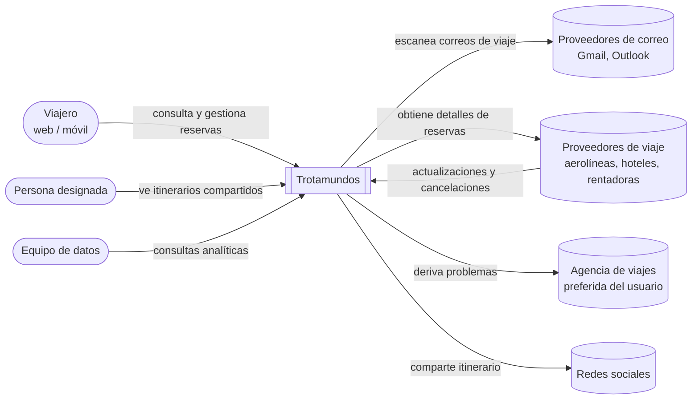

# Análisis inicial y drivers arquitectónicos

> Etapa previa a las iteraciones de ADD. Define el alcance del sistema **Trotamundos** y el conjunto priorizado de drivers (funcionalidad primaria, atributos de calidad y restricciones) que se mantendrán **inmutables** durante el proceso de diseño.

**Estado:** Completo
**Última actualización:** 11/10/2026

---

## 1. Objetivo

Identificar el alcance del sistema, sus límites e interacciones con actores externos, y priorizar los requerimientos funcionales y de atributos de calidad que guiarán las iteraciones de ADD.

---

## 2. Diagrama de contexto

---

## 3. Requerimientos funcionales

### 3.1 Funcionalidad primaria (drivers de ADD)

| ID | Caso de uso | Justificación |
|---|---|---|
| CU-01 | Consultar el panel de viajes (web y móvil) | Es la propuesta de valor del producto ("único punto de verdad") y concentra la mayor parte del tráfico. Sobre él recaen los requisitos de tiempo de respuesta, disponibilidad y picos de carga. |
| CU-02 | Recibir actualizaciones y cancelaciones de proveedores | Es el camino del requisito de 5 minutos y el más afectado por disrupciones masivas. Obliga a una arquitectura orientada a eventos. |
| CU-03 | Incorporar reservas desde el correo | Es el diferencial del producto. Involucra seguridad (acceso al correo), interoperabilidad con proveedores de correo y el mayor desafío de escala. |
| CU-04 | Compartir un itinerario con personas designadas | Es la forma concreta que toma el requisito de seguridad y privacidad en el enunciado. |

### 3.2 Funcionalidad secundaria (se implementa, no guía el diseño)

| ID | Caso de uso | Tratamiento |
|---|---|---|
| CU-05 | Analítica de datos | Se diseña su aislamiento del sistema operativo; en el prototipo se limita a copiar periodicamente los registros en un almacen analitico propio. |
| CU-06 | Gestión manual de reservas (alta, modificación, baja) | Se implementa completo. Es la forma más simple de cargar datos en el prototipo. |
| CU-07 | Agrupar reservas por viaje y archivado automático | Se resuelve con el modelo de dominio y una tarea programada. |
| CU-08 | Filtros y *whitelists* de remitentes | Paso de filtrado dentro del pipeline de CU-03. |
| CU-09 | Resolución de problemas con la agencia de viajes | Adaptador contra una agencia simulada. |

---

## 4. Atributos de calidad

Las medidas marcadas con \* fueron propuestas por el equipo para que el escenario sea verificable; el enunciado no las define.

| ID | Atributo | Escenario | Caso de uso | Prioridad | Dificultad |
|---|---|---|---|---|---|
| QA-1 | Performance | El sistema deberá mostrar en el panel las actualizaciones generadas por un proveedor externo en menos de 5 minutos. | CU-01, 02 | Alta | Alta |
| QA-2 | Performance | El sistema deberá responder las solicitudes del panel web en menos de 800 ms con carga normal. | CU-01 | Media | Baja |
| QA-3 | Performance | Cuando un usuario abre la aplicacion, el primer despliegue de contenido (*First Contentful Paint*) ocurre en menos de 1,4 segundos. | CU-01 | Baja | Media |
| QA-4 | Disponibilidad | El sistema completo deberá tolerar la caída de una instanciao de una zona cuando se produzca una falla externa sin superar 5 minutos mensuales de inactividad no planificada (≈ 99,99%). | Todos | Alta | Alta |
| QA-5 | Disponibilidad | Cuando la API de un proveedor externo deja de responder, el sistema sigue mostrando la última versión conocida del viaje y, dentro de los 5 minutos\* posteriores al restablecimiento de la API, recupera y procesa el 99% de los eventos generados durante la interrupción. | CU-01, 02 | Media | Media |
| QA-6 | Escalabilidad | El sistema deberá soportar 15 M de cuentas y 2 M de usuarios activos semanales y, ante picos de hasta ×10\*, seguir cumpliendo QA-1 y QA-2. | CU-01, 02 | Alta | Alta |
| QA-7 | Escalabilidad | Cuando la base de cuentas crece hasta 15 M durante la operación normal, el sistema, incorporando recursos de procesamiento, procesa el correo de los usuarios con viajes próximos con una demora máxima de 15 minutos\* para el 95%\* de ellos. | CU-03 | Media | Media |
| QA-8 | Interoperabilidad | Cuando los sistemas de proveedores externos envían notificaciones mediante sus APIs estándar durante la operación normal, el sistema procesa correctamente el 99% de los mensajes válidos e identifica y registra el 99% de los inválidos, sin interrumpir la integración con el resto de los proveedores. | CU-02 | Alta | Media |
| QA-9 | Interoperabilidad | El sistema deberá extraer correctamente la reserva del 95%\* de los emails de remitentes en la *whitelist*, dentro de los formatos soportados y en menos de 15 segundos. | CU-03 | Media | Media |
| QA-10 | Seguridad | Cuando un usuario revoca el acceso a su correo durante la operación normal, el sistema deja de leer ese correo en menos de 1 minuto\* y no realiza ninguna lectura posterior con el token revocado (0 accesos). | CU-03 | Media | Media |
| QA-11 | Seguridad | Cuando una persona no designada quiera ver un itinerario compartido; el sistema rechazará y registrará el 100% de los accesos no autorizados. | CU-04 | Baja | Baja |
| QA-12 | Evolucionabilidad | Cuando el negocio decide incorporar un nuevo medio de transporte (por ejemplo, trenes), el sistema lo soporta sin modificar los componentes existentes del núcleo, con un esfuerzo máximo de 2 días-persona\*. | CU-02, 03 | Media | Baja |

### 4.1 Criterio de priorización

- **Prioridad:** importancia para el objetivo central del producto, ofrecer un único punto de verdad, actualizado, para los arreglos de viaje.
- **Dificultad:** incertidumbre técnica sobre la posibilidad de cumplir el escenario (riesgo técnico, en terminología del SEI), no cantidad de trabajo.

## 5. Restricciones del sistema

Decisiones que el diseño debe respetar y que no se discuten durante ADD.

| ID | Restricción | Tipo |
|---|---|---|
| R-1 | El sistema debe ser multiplataforma: accesible desde navegadores web (multibrowser) y desde dispositivos móviles. | Técnica |
| R-2 | La integración con aerolíneas, hoteles y rentadoras debe realizarse a través de las APIs estándar que esos proveedores ya exponen. El sistema se adapta a sus contratos; no puede modificarlos. | Técnica |
| R-3 | El sistema depende de sistemas externos que no controla (proveedores de viaje, correo y agencias): su disponibilidad, formatos y límites de uso son condiciones dadas. | Técnica |
| R-4 | Al procesar información personal y operar en el mercado internacional, el sistema debe cumplir las normativas de protección de datos de cada región donde opere. | Legal |
| R-5 | El sistema no garantizara soporte optimo a celulares con tecnologia de telefonia movil de 3GB o inferior | Técnica |

## 6. Concerns
| ID | Concern |
|---|---|
| CRN-1 | Establecer la estructura general del sistema.
| CRN-2 | Aprovechar los conocimientos tecnologicos del equipo (java,POSTGRE,C++, python entre otros).
| CRN-3 | Aislar los Casos de uso secundarios.

---
