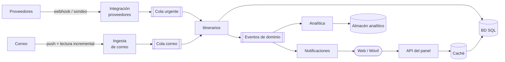
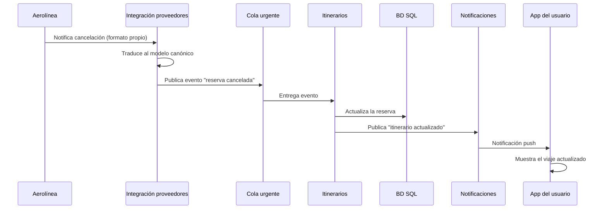

# Iteración 1: Estructura general del sistema

**Estado:** Completa
**Fecha:** 08/10/2026

---

## 1. Revisión de entradas

Se parte de los drivers definidos en [Análisis inicial y drivers](Analisis-Inicial-y-Drivers): casos de uso primarios (CU-01 a CU-04), atributos de calidad (QA-1 a QA-16), restricciones del sistema (R-1 a R-6) y preocupaciones arquitectónicas (PA-1 a PA-4).

---

## 2. Objetivo de la iteración

Establecer la estructura general del sistema: el estilo arquitectónico, la forma en que fluyen los eventos de actualización y cómo se persisten los datos de reservas y correo.

### Drivers considerados

| Driver | Descripción | Prioridad | Dificultad |
|---|---|---|---|
| CU-01 | Consultar el panel de viajes | Primario | — |
| CU-02 | Recibir actualizaciones y cancelaciones de proveedores | Primario | — |
| CU-03 | Incorporar reservas desde el correo | Primario | — |
| QA-1 | Actualizaciones en el panel en < 5 min | Alta | Alta |
| QA-7 | Picos de tráfico ante disrupciones | Alta | Alta |
| QA-9 | Integración con proveedores vía APIs estándar | Alta | Media |
| QA-13 | Agregar un medio de transporte sin tocar el núcleo | Media | Baja |
| R-4 | Base de datos relacional (SQL) | Restricción | — |
| R-6 | Protección de datos personales | Restricción | — |

---

## 3. Elementos a refinar

Al ser la primera iteración, se refina el **sistema Trotamundos completo**, tal como aparece en el diagrama de contexto.

---

## 4. Conceptos de diseño seleccionados

| Concepto | Tipo | Alternativas descartadas | Driver | ADR |
|---|---|---|---|---|
| Microservicios | Patrón de referencia | Monolito modular, monolito en capas | QA-7, QA-5, QA-13 | [ADR-001](ADR-001-Estilo-arquitectonico) |
| Arquitectura orientada a eventos (publicación/suscripción) | Patrón | Llamadas sincrónicas entre servicios | QA-1, QA-7 | [ADR-001](ADR-001-Estilo-arquitectonico) |
| Colas separadas por urgencia | Táctica: priorizar eventos | Cola única compartida | QA-1, QA-7 | [ADR-002](ADR-002-Mensajeria-y-escalado) |
| Autoescalado de consumidores por longitud de cola | Táctica: introducir concurrencia | Cantidad fija de consumidores | QA-7 | [ADR-002](ADR-002-Mensajeria-y-escalado) |
| Colas de mensajes fallidos (*dead-letter*) | Táctica: aislamiento de fallas | Reintentos indefinidos | QA-9, QA-6 | [ADR-002](ADR-002-Mensajeria-y-escalado) |
| Adaptadores por proveedor y modelo canónico | Patrón: capa anticorrupción | Integración directa con cada formato | QA-9, QA-13 | [ADR-001](ADR-001-Estilo-arquitectonico) |
| Base de datos SQL sin correos crudos | Decisión de persistencia | Guardar correos crudos, base documental | R-4, R-6, QA-11 | [ADR-003](ADR-003-Persistencia-de-correos) |

---

## 5. Elementos instanciados y responsabilidades

| Elemento | Responsabilidad | Casos de uso |
|---|---|---|
| API del panel | Atender las consultas de los clientes web y móvil; lee desde una caché del itinerario. | CU-01 |
| Itinerarios | Núcleo de dominio: reservas, agrupación por viaje, archivado y gestión manual. Publica eventos cuando cambia un viaje. | CU-06, CU-07 |
| Integración con proveedores | Recibir o sondear actualizaciones de aerolíneas, hoteles y rentadoras; traducirlas al modelo canónico mediante un adaptador por proveedor. | CU-02 |
| Ingesta de correo | Leer de forma incremental las casillas con novedades, filtrar por *whitelist* y extraer reservas. | CU-03, CU-08 |
| Notificaciones | Avisar a los clientes web y móvil cuando cambia un viaje. | CU-01, CU-02 |
| Analítica | Consumir eventos de dominio y alimentar un almacén analítico propio. | CU-05 |
| Broker de mensajería | Transportar los eventos mediante colas separadas por urgencia. | CU-02, CU-03 |

---

## 6. Vistas

### 6.1 Vista de componentes y conectores

### 6.2 Diagrama de secuencia: cancelación de un vuelo

### 6.3 Decisiones registradas

- [ADR-001: Estilo arquitectónico](ADR-001-Estilo-arquitectonico)
- [ADR-002: Mensajería y escalado de consumidores](ADR-002-Mensajeria-y-escalado)
- [ADR-003: Persistencia de datos de correo](ADR-003-Persistencia-de-correos)

---

## 7. Análisis y estado de los drivers

| Driver | Estado | Comentario |
|---|---|---|
| CU-01 | Parcial | Definidos la API del panel y la caché; falta el detalle del modelo de lectura. |
| CU-02 | Parcial | Definido el flujo asíncrono con adaptadores; faltan los contratos con proveedores. |
| CU-03 | Parcial | Definido el servicio de ingesta y su persistencia; falta el diseño del pipeline de extracción. |
| CU-04 | No abordado | — |
| QA-1 | Parcial | Camino asíncrono con cola prioritaria y notificaciones; falta validar el tiempo total. |
| QA-4 | Parcial | La analítica tiene almacén propio y no consulta la base operativa. |
| QA-5 | Parcial | Los microservicios aíslan fallas; falta la estrategia de redundancia. |
| QA-6 | Parcial | Las colas desacoplan a los proveedores; falta definir el comportamiento del panel ante su caída. |
| QA-7 | Parcial | Autoescalado de consumidores; falta el escalado de la lectura del panel. |
| QA-9 | Parcial | Adaptadores, modelo canónico y colas de mensajes fallidos; faltan los contratos. |
| QA-11 | Parcial | Se guarda solo la referencia al token de acceso; falta el diseño de autorización. |
| QA-13 | Parcial | Un adaptador por proveedor; falta definir el modelo canónico extensible. |
| Resto | No abordado | — |

**Próxima iteración:** camino de actualizaciones y lectura del panel bajo carga (QA-1, QA-2, QA-3, QA-7).
