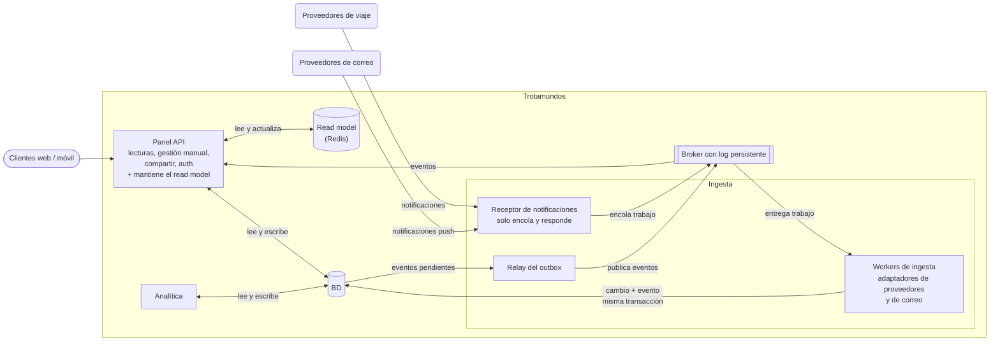

# Iteración 1 de ADD: estructura general de Trotamundos

- **Estado:** Borrador para revisión
- **Fecha:** 21/10/2026 (versión 3, ver historial al final)
- **Equipo:** grupo TPE
---

## 1. Resumen ejecutivo

Esta iteración fija la estructura global de Trotamundos. Se eligió una arquitectura en capas/hexagonal con **tres desplegables** (Panel API, ingesta y analítica). La ingesta y el Panel API se comunican por un **broker con log persistente y outbox**, el panel lee de un **read model** propio (CQRS solo en el panel) y la analítica queda aislada del sistema operativo, con su diseño detallado para iteraciones futuras (alternativa C-lite del ADR-0001, con los ADR-0002 a 0004).

La estructura da un camino de cumplimiento defendible a los drivers de prioridad y dificultad Alta (QA-1, QA-6) y deja la evolución hacia más servicios como camino previsto, sin reescritura. Los riesgos aceptados en los ADR se consolidan en **cuatro concerns nuevas** (sección 5), con una iteración prevista para cada una.

## 2. Objetivo de la iteración y drivers seleccionados

**Objetivo.** Establecer la estructura global del sistema (estilo arquitectónico, comunicación entre desplegables y aislamiento de la analítica) de modo que los drivers de mayor prioridad y dificultad tengan un camino de cumplimiento defendible y el diseño sea implementable por el grupo en el plazo del TPE.

Al tratarse de un desarrollo nuevo, el elemento a refinar es el **sistema completo**, que en esta iteración se descompone (refinamiento por descomposición) en desplegables y almacenes de apoyo.

| Driver | Motivo de la selección |
|---|---|
| CU-01, CU-02, CU-03, CU-04 | Funcionalidad primaria. Concentran la mayor parte de los requisitos de calidad. |
| QA-1, QA-6 | Prioridad Alta y dificultad Alta. Condicionan el estilo arquitectónico. |
| QA-2, QA-3, QA-5, QA-7 | Intervienen en la decisión de estilo. Se abordan de forma parcial o quedan pendientes. |
| R-2, R-6 | R-2 moldea la integración (adaptadores por proveedor). R-6 (prototipo en plazo acotado) hace de la viabilidad de implementación un criterio de decisión de primer orden. |
| CRN-3 | Aislar los casos de uso secundarios. En esta iteración solo se diseña el aislamiento de la analítica (CU-05) respecto del sistema operativo. El diseño detallado queda para iteraciones futuras. |
| CRN-1 | Se moldea el concepto general del sistema (ADR-0001). |

## 3. Conceptos de diseño

En esta primera iteración se documentan solo los conceptos que se desprenden directamente de los ADR. Las tácticas de detalle que enumera el ADR-0001 (circuit breaker, reintentos, cola de mensajes inválidos y otras) no se repiten acá.

| Concepto | Drivers | ADR | Alternativas descartadas |
|---|---|---|---|
| Arquitectura en capas/hexagonal con 3 desplegables (C-lite) | QA-1, QA-2, QA-3, QA-5, QA-6, QA-7, R-2, R-6, CRN-1, CRN-3 | 0001 | Monolito modular (A), microservicios (B), híbrida de 5-6 servicios (C), serverless (D), capas/N-tier (E) |
| Workers de ingesta asíncronos, con un adaptador por proveedor y por medio de transporte | CU-02, CU-03, QA-1, QA-5, QA-6, QA-7, R-2 | 0002 | Procesar en el receptor, un servicio por proveedor, funciones serverless por evento |
| Outbox transaccional con relay por polling | QA-1, QA-5 | 0002 | Doble escritura directa, publicar primero y guardar después, captura de cambios (CDC), transacción distribuida |
| Broker con log persistente, con un stream de trabajo (buffer de entrada) y uno de eventos | QA-1, QA-5, QA-6, QA-7 | 0003 | Comunicación síncrona directa, base de datos como bus, cola durable simple, plataforma de streaming completa |
| Read model del panel en un almacén clave-valor en memoria (CQRS solo en el panel) | CU-01, CU-04, QA-1, QA-2, QA-3, QA-6 | 0004 | Sin read model, tablas de lectura en la base relacional, base documental propia |

**Tecnologías.** El read model usa Redis (ADR-0004). La tecnología del broker queda abierta entre Redis Streams y RabbitMQ Streams (ADR-0003, sección 6). El motor de la BD queda por definir.

**Costo explícito.** La estructura suma piezas que operar (broker, relay, read model) y datos que mantener consistentes entre sí. Ese costo se refleja en las concerns de la sección 5.

## 4. Vista modular y elementos instanciados

### 4.1 Vista modular

**Clave.** Los rectángulos son elementos de código desplegable, los cilindros son almacenes, el rectángulo con doble borde es el broker y los óvalos son actores externos. Las flechas son comunicación, con su sentido y su motivo.

### 4.2 Elementos y responsabilidades

| Elemento | Responsabilidades | Comunicación |
|---|---|---|
| **Panel API** | Lecturas del panel (CU-01), gestión manual de reservas (CU-04), compartir itinerarios y autenticación. Mantiene el read model a partir de los eventos y de sus propios cambios. | HTTP con clientes web y móvil. Lee y escribe en la BD. Lee y actualiza el read model. Consume el stream de eventos del broker. |
| **Read model** | Copia derivada del panel: un documento por viaje y un índice por usuario, con la lista de personas autorizadas a ver cada itinerario. No es fuente de verdad: se reconstruye desde la BD. | Lo lee y lo actualiza el Panel API. |
| **Ingesta: receptor de notificaciones** | Recibe las notificaciones push de proveedores de viaje y de correo, verifica su autenticidad, las encola y responde. | Recibe de los proveedores. Publica en el stream de trabajo del broker. |
| **Ingesta: workers** | Adaptadores de proveedores de viaje (CU-02) y de correo (CU-03). Traducen al modelo canónico. Guardan el cambio y el evento en la BD en una sola transacción (outbox). | Toman trabajo del stream de trabajo. Consultan a los proveedores. Escriben en la BD. |
| **Ingesta: relay del outbox** | Publica en el stream de eventos los eventos pendientes del outbox. | Lee de la BD. Publica en el broker. |
| **Broker con log persistente** | Dos streams: de trabajo (buffer de entrada) y de eventos (hacia el panel). Buffer de picos, replay dentro de la retención y reintentos. | Producción: receptor y relay. Consumo: workers y Panel API. |
| **BD** | Usuarios, viajes, reservas, permisos, auditoría y outbox. Motor por definir. | Panel API, workers, relay y analítica. |
| **Analítica** | Queda aislada del sistema operativo (CRN-3). Su diseño detallado queda para iteraciones futuras. | Según la vista, lee y escribe en la BD. El detalle del acceso se define en iteraciones futuras. |

Las interfaces concretas (contratos de trabajo y de eventos, modelo canónico y API del panel) quedan para las próximas iteraciones.

## 5. Consecuencias negativas y nuevos drivers

Los ADR-0001 a 0004 registran 19 riesgos aceptados. Muchos se repiten entre ADR o se resuelven con drivers que ya están en la sección 2. Para no cerrar la iteración con una lista inmanejable, se consolidan en **cuatro concerns nuevas**. Los identificadores W, B y RM son los de los ADR-0002, 0003 y 0004. Los riesgos del ADR-0001 se citan por su nombre. Los IDs de las concerns son provisionales hasta incorporarlas al catálogo de drivers.

### 5.1 Concerns nuevas

| ID | Concern | Riesgos de origen | Mitigación ya prevista en los ADR |
|---|---|---|---|
| CRN-N1 | Aislar la falla de un proveedor del resto de la ingesta | ADR-0001 (radio de impacto), W-1 | Colas, pools y circuit breaker por proveedor dentro del worker. |
| CRN-N2 | Evitar que la base operacional compartida sea el cuello de botella | ADR-0001 (base compartida), W-2, W-3, RM-1 | Cada módulo es dueño de sus tablas. Partición y descarte del outbox. Lecturas por clave indexada y agrupadas. Réplica de lectura. Prueba de carga. |
| CRN-N3 | Operar y mantener disponibles el broker, el relay y el read model | ADR-0001 (un broker más), B-4, W-4, RM-5 | Broker gestionado o clusterizado y multi-AZ. El receptor responde con error para que el proveedor reintente. Alertas por antigüedad de la fila pendiente y retraso de consumo. Reinicio automático. |
| CRN-N4 | Mantener consistentes los datos entre BD, log y read model, y poder reconstruirlos | B-2, W-5, RM-3, RM-2 | Idempotencia por id de evento y versión. Escritura condicional por versión en el read model. Reconstrucción del read model desde la BD. |

## 6. Estado de los drivers al cierre

Evaluación para esta documentación, con tres estados: no abordado, parcialmente abordado y abordado. La tabla muestra los drivers abordados o parcialmente abordados. Los no abordados se listan debajo.

| Driver | Estado | Fundamento | Pendiente |
|---|---|---|---|
| CRN-1 | Abordado | Estructura general definida y justificada: C-lite con tres desplegables, broker, outbox y read model. | — |
| CRN-3 | Parcial | La analítica (CU-05) queda como desplegable aislado del sistema operativo. | Diseño del aislamiento y del acceso a los datos. Aislamiento del resto de los casos de uso secundarios. |
| R-2 | Abordado a nivel de estructura | Adaptadores por proveedor y por medio de transporte en los workers. | Contratos concretos y modelo canónico. |
| R-6 | Parcial | Se descartaron las alternativas de mayor costo de implementación (microservicios, híbrida, serverless, plataforma de streaming). Tres desplegables ejecutables con docker-compose y proveedores simulados. | Reverificar el esfuerzo en cada iteración, en particular el costo de operar las piezas nuevas (CRN-N3). |
| CU-01 | Parcial | El Panel API lee del read model, mantenido por eventos. | Diseño de las lecturas del panel. |
| CU-02 | Parcial | Workers con un adaptador por proveedor de viaje. | Modelo canónico y contratos de adaptadores. |
| CU-03 | Parcial | Workers con adaptador de correo y buffer de entrada. | Pipeline de ingesta de correo. |
| CU-04 | Parcial | El Panel API guarda el cambio manual en la BD y actualiza el read model directamente, sin pasar por el broker. | API de gestión manual de reservas y reglas de validación. |
| QA-1 | Parcial | Buffer de entrada, outbox, log persistente y read model actualizado por eventos. | Presupuesto de tiempo por etapa, tecnología del broker e intervalo del relay. |
| QA-2, QA-3 | Parcial | El panel lee de un read model en memoria, aislado de las escrituras de la ingesta. | Dimensionamiento y prueba de carga. QA-3 depende además del cliente. |
| QA-5 | Parcial | La última versión conocida queda en la BD y se sirve desde el read model. Outbox sin pérdida y replay del log dentro de la retención. | Reconciliación con el proveedor al restablecerse la API, valor de retención y política de recuperación dentro de los 5 minutos. |
| QA-6 | Parcial | Ingesta escalable por separado, buffer de entrada y lecturas aisladas de las escrituras. | CRN-N2. Dimensionamiento. |
| QA-7 | Parcial | Workers escalables de forma independiente y buffer de entrada. | Pipeline de ingesta de correo. |

### Drivers no abordados

Los siguientes drivers del análisis inicial no se abordan en esta iteración, y las concerns nuevas quedan pendientes:

- **Funcionalidad secundaria:**
  - CU-05 (analítica de datos; solo se registra su aislamiento a través de CRN-3)
  - CU-06 (compartir un itinerario con personas designadas)
  - CU-07 (agrupar reservas por viaje y archivado automático)
  - CU-08 (filtros y *whitelists* de remitentes)
  - CU-09 (resolución de problemas con la agencia de viajes)
- **Atributos de calidad:**
  - QA-4 (disponibilidad del sistema completo)
  - QA-8 (interoperabilidad: mensajes válidos e inválidos de proveedores)
  - QA-9 (extracción de reservas desde el correo)
  - QA-10 (revocación del acceso al correo)
  - QA-11 (acceso a itinerarios compartidos)
  - QA-12 (incorporar un nuevo medio de transporte)
- **Restricciones:**
  - R-1 (sistema multiplataforma)
  - R-3 (dependencia de sistemas externos)
  - R-4 (protección de datos por región)
  - R-5 (soporte limitado en celulares de tecnología móvil antigua)
- **Concerns:**
  - CRN-2 (aprovechar los conocimientos tecnológicos del equipo)
- **Concerns nuevas de esta iteración:**
  - CRN-N1 (aislar la falla de un proveedor, Iteración 2)
  - CRN-N2 (capacidad de la base compartida, Iteración 3)
  - CRN-N3 (operar broker, relay y read model, Iteración 3)
  - CRN-N4 (consistencia y reconstrucción de datos, Iteraciones 2 y 3)

## 7. Decisiones pendientes y próximas iteraciones

ADR necesarios, derivados de las concerns nuevas y de los drivers parciales:

1. Modelo canónico y contratos de adaptadores (R-2, CU-02, CU-03, CRN-N1).
2. Contratos de mensajes del stream de trabajo y del de eventos: identificador, versión y clave de orden (CRN-N4).
3. Tecnología del broker (ADR-0003, sección 6), valor de retención del log y revisión del valor del replay (QA-5, B-5).
4. Reconciliación con los proveedores y política de recuperación tras una interrupción, dentro de los 5 minutos (QA-5).
5. Pipeline de ingesta de correo (CU-03, QA-7).
6. Almacenamiento operacional: motor de la base, partición del outbox, capacidad y réplica de lectura (CRN-N2).
7. Despliegue, alta disponibilidad y monitoreo del broker, el relay y el read model (CRN-N3).
8. Lecturas del panel, gestión manual de reservas y reconstrucción del read model (CU-01, CU-04, CRN-N4).
9. Aislamiento de la analítica y acceso a los datos (CRN-3).

Propuesta de orden:

- **Iteración 2: ingesta y eventos.** Modelo canónico, adaptadores, contratos de mensajes, tecnología del broker, reconciliación con proveedores y pipeline de correo (CU-02, CU-03, QA-1, QA-5, QA-7, R-2, CRN-N1, CRN-N4).
- **Iteración 3: panel, almacenamiento y disponibilidad.** Lecturas del panel, gestión manual, almacenamiento operacional, despliegue y monitoreo (CU-01, CU-04, QA-2, QA-3, QA-6, CRN-N2, CRN-N3).
- **Iteración 4 o posterior.** Aislamiento de la analítica (CRN-3).
