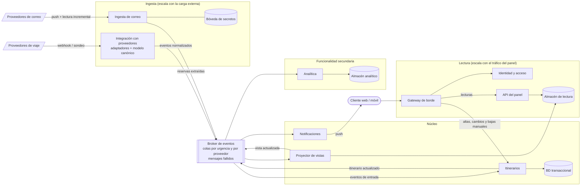
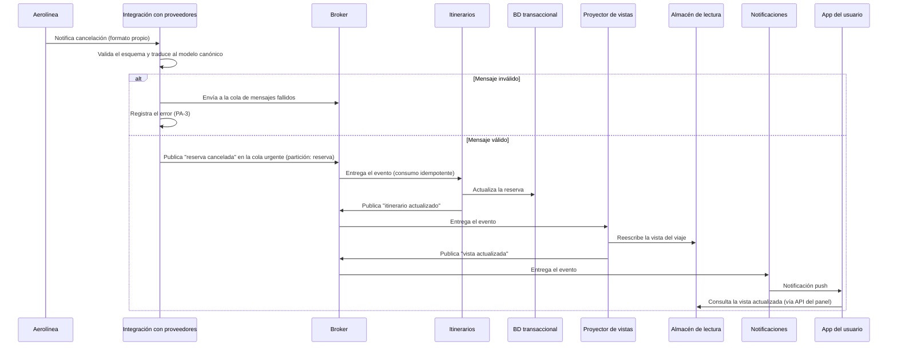
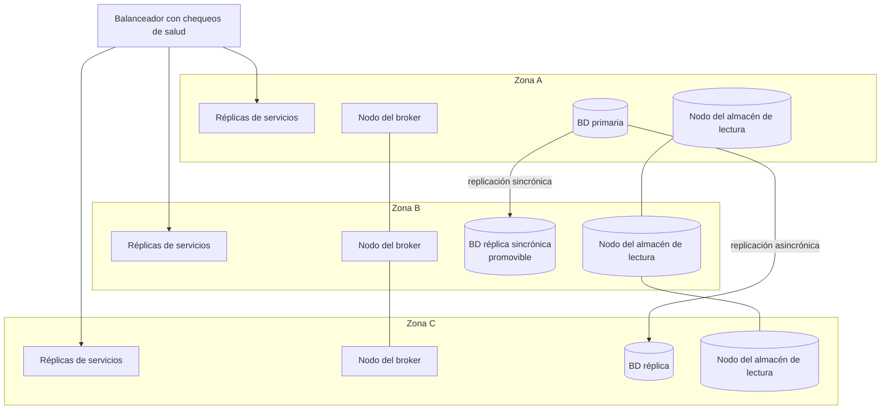

# Iteración 1: Estructura general del sistema
 
**Estado:** Completa, con decisiones pendientes de validación (los ADRs se redactan después de validarlas)
**Fecha:** 12/10/2026
 
---
 
## 1. Revisión de entradas
 
Se parte de los drivers definidos en [Análisis inicial y drivers](Analisis-Inicial-y-Drivers): casos de uso primarios (CU-01 a CU-04), atributos de calidad (QA-1 a QA-16), restricciones del sistema (R-1 a R-5) y preocupaciones arquitectónicas (PA-1 a PA-4).
 
---
 
## 2. Objetivo de la iteración
 
Establecer la estructura general del sistema para satisfacer los **atributos de calidad de prioridad alta** (QA-1, QA-5, QA-7 y QA-9) sobre la funcionalidad primaria. Esto incluye el estilo arquitectónico, el camino de las actualizaciones externas hasta el panel, la lectura del panel bajo carga, el aislamiento de las integraciones externas y la estrategia de redundancia.
 
### 2.1 Drivers abordados directamente
 
| Driver | Descripción | Prioridad | Dificultad |
|---|---|---|---|
| CU-01 | Consultar el panel de viajes | Primario | n/a |
| CU-02 | Recibir actualizaciones y cancelaciones de proveedores | Primario | n/a |
| CU-03 | Incorporar reservas desde el correo | Primario | n/a |
| CU-04 | Compartir un itinerario con personas designadas | Primario | n/a |
| QA-1 | Actualizaciones visibles en el panel en menos de 5 min | Alta | Alta |
| QA-5 | Tolerar la caída de una instancia o zona (≤ 5 min/mes de inactividad) | Alta | Alta |
| QA-7 | 15 M de cuentas, 2 M de usuarios activos semanales y picos ×10 sin perder QA-1 ni QA-2 | Alta | Alta |
| QA-9 | Integración con proveedores vía APIs estándar sin que un proveedor afecte a otro | Alta | Media |
 
Los casos de uso primarios guían la iteración porque son la funcionalidad primaria del análisis inicial. En esta iteración solo se les asigna responsabilidad estructural (sección 5). Su diseño interno se completa en iteraciones posteriores.
 
### 2.2 Restricciones y preocupaciones que condicionan las decisiones
 
| ID | Efecto en la iteración |
|---|---|
| R-1 | Los clientes web y móvil consumen una misma API versionada (PA-4). |
| R-2 | La integración se adapta a los contratos estándar de los proveedores y no puede modificarlos. |
| R-3 | El correo se accede con autorización delegada. El sistema nunca almacena contraseñas. |
| R-4 | Los proveedores son sistemas que no se controlan: su disponibilidad y sus límites de uso son datos del problema. |
| R-5 | Protección de datos personales: se minimiza qué se persiste del correo. |
| PA-1 | Existe un elemento dedicado a identidad y acceso. |
| PA-2 | El modelo canónico guarda las fechas en UTC junto con la zona horaria de origen. |
| PA-3 | Todo mensaje inválido o agotado queda registrado (cola de mensajes fallidos). |
 
### 2.3 Drivers que se benefician indirectamente
 
Los drivers de prioridad media o baja que mejoran como consecuencia de las decisiones se analizan en la sección 7.2, con el mecanismo que produce el beneficio.
 
---
 
## 3. Elementos a refinar
 
Al ser la primera iteración, se refina el **sistema Trotamundos completo**, tal como aparece en el diagrama de contexto.
 
---
 
## 4. Conceptos de diseño seleccionados
 
### 4.1 Resumen
 
| ID | Decisión | Tipo | Drivers directos | Drivers indirectos | Alternativas consideradas | ADR |
|---|---|---|---|---|---|---|
| D-01 | Servicios de grano grueso, divididos por carga de trabajo | Patrón de referencia | QA-7, QA-5 | QA-13, QA-4, QA-8 | Monolito modular de despliegue único; monolito en capas; microservicios de grano fino por entidad | Pendiente |
| D-02 | Arquitectura orientada a eventos con broker durable (publicación/suscripción) | Patrón | QA-1, QA-7, QA-9 | QA-6, QA-8, QA-4 | Llamadas sincrónicas entre servicios; sondeo sobre la base de datos | Pendiente |
| D-03 | Colas separadas por urgencia y partición por reserva | Táctica: priorizar eventos | QA-1, QA-7 | n/a | Cola única FIFO | Pendiente |
| D-04 | Servicios sin estado y autoescalado (programado y reactivo al backlog) | Táctica: introducir concurrencia | QA-7, QA-5 | QA-2 | Capacidad fija dimensionada para el pico; escalado vertical | Pendiente |
| D-05 | Modelo de lectura separado del de escritura (CQRS ligero) | Patrón | QA-7, QA-5 | QA-2, QA-6, QA-3 | Lectura directa de la BD con caché *cache-aside*; réplicas de lectura de la BD | Pendiente |
| D-06 | Capa anticorrupción: adaptador por proveedor, modelo canónico y validación en el borde | Patrón | QA-9 | QA-13, QA-14 | Integración directa de cada formato en el núcleo | Pendiente |
| D-07 | Aislamiento de fallas por proveedor y consumo idempotente | Táctica: *bulkhead*, *circuit breaker*, reintentos con *backoff*, cola de mensajes fallidos | QA-9, QA-5 | QA-6 | Pool compartido de consumidores; reintentos indefinidos | Pendiente |
| D-08 | Ingesta con *push* primero y sondeo priorizado por cercanía del viaje como respaldo | Táctica: reducir la latencia de origen | QA-1, QA-7 | QA-6, QA-8 | Sondeo uniforme de todas las reservas | Pendiente |
| D-09 | Redundancia en 3 zonas de disponibilidad con *failover* automático | Táctica: redundancia activa, detección y recuperación de fallas | QA-5 | QA-7, QA-6 | Una sola zona con *backups*; multi-región activo-activo desde el inicio | Pendiente |
| D-10 | Base transaccional relacional particionable por usuario, sin correos crudos y con tokens en una bóveda de secretos | Decisión de persistencia | QA-7, QA-5 | QA-11 | Base documental; persistir correos crudos | Pendiente |
 
### 4.2 Justificación y costos de cada decisión
 
**D-01. Servicios de grano grueso por carga de trabajo.** El sistema tiene tres cargas con perfiles de escala y de falla muy distintos: lectura del panel, ingesta externa (proveedores y correo) y núcleo de dominio. Separarlas permite escalar cada una por su cuenta (QA-7) y que una tormenta de ingesta no tumbe el panel (QA-5). El costo es la complejidad distribuida: contratos versionados, observabilidad y despliegues coordinados. Se mitiga con pocos servicios (alrededor de 8) divididos por carga y no por entidad. *El prototipo implementará solo un subconjunto.*
 
**D-02. Arquitectura orientada a eventos.** El camino de QA-1 es asíncrono por naturaleza: llega un mensaje externo, se procesa y se propaga. Un broker durable desacopla los ritmos de productores y consumidores, absorbe los picos de QA-7 y no pierde eventos si un consumidor cae. El costo es consistencia eventual, entrega al menos una vez (posibles duplicados, ver D-07) y orden solo garantizado por partición (ver D-03).
 
**D-03. Colas por urgencia y partición por reserva.** Las cancelaciones y cambios de horario de viajes cercanos van por una cola urgente y las altas desde correo y cambios menores por una cola normal. Así una avalancha de correos no retrasa una cancelación (QA-1). La clave de partición es la reserva, de modo que se conserva el orden de los eventos de una misma reserva aunque haya muchos consumidores en paralelo. El riesgo es la inanición de la cola normal, por lo que se reserva una capacidad mínima para ella.
 
**D-04. Servicios sin estado y autoescalado.** Sin estado en memoria, cualquier réplica atiende cualquier solicitud, lo que habilita QA-7 y que se pierda una instancia sin impacto (QA-5). Los picos del enunciado son de dos tipos. Los de domingo-lunes y jueves-viernes son predecibles y se cubren con escalado programado. Las disrupciones masivas no lo son y se cubren con escalado reactivo a la longitud de cola y a la carga. El costo es el retardo del escalado reactivo, que se mitiga con una capacidad mínima siempre activa.
 
**D-05. CQRS ligero.** El panel lee una vista del itinerario ya armada (denormalizada), mantenida por un proyector que consume los eventos de dominio. Se elige sobre *cache-aside* porque, en un pico con caché fría, esa alternativa traslada la carga a la base. La vista proyectada está siempre completa, se reconstruye desde los eventos o desde la base, y sigue sirviendo si la base o un proveedor están caídos. Costos: consistencia eventual y almacenamiento duplicado. Para CU-06 (edición manual) el usuario podría no ver su cambio de inmediato. Se mitiga devolviendo la vista actualizada en la respuesta del comando o con actualización optimista en el cliente. Las notificaciones se emiten después de actualizar la vista, para que el aviso nunca llegue antes que el dato.
 
**D-06. Capa anticorrupción.** Cada proveedor tiene su propio adaptador, que valida el mensaje en el borde y lo traduce a un modelo canónico (con fechas en UTC y zona de origen, PA-2). El núcleo nunca ve formatos externos. El riesgo es que un modelo canónico muy rígido pierda información específica de un proveedor, por lo que incluirá campos opcionales de extensión. Su diseño detallado queda para una iteración posterior.
 
**D-07. Aislamiento por proveedor e idempotencia.** Cada proveedor tiene su cola, su pool de consumidores y su límite de uso (*bulkhead*), y las llamadas salientes usan *circuit breaker*. Así un proveedor lento o que envía basura no interrumpe a los demás (QA-9). Los mensajes inválidos o con reintentos agotados van a la cola de mensajes fallidos, quedan registrados (PA-3) y se consideran perdidos solo si nadie los revisa. Los consumidores son idempotentes (por identificador de evento) para tolerar duplicados. El costo es operar más colas.
 
**D-08. Ingesta *push* primero.** Donde el proveedor ofrece *webhooks*, se usan. Donde no, se sondea con una frecuencia que depende de la cercanía del viaje: alta para viajes próximos, baja para el resto. Sondear todo con la misma frecuencia desperdicia cuota (R-4) y capacidad (QA-7). El mismo criterio aplica al correo: notificaciones *push* del proveedor de correo y lectura incremental solo de las casillas con novedades (ver supuestos del análisis inicial). Los umbrales (por ejemplo, 72 h y 2 min) son supuestos a validar, y las capacidades reales de cada proveedor son un riesgo (R-4).
 
**D-09. Tres zonas de disponibilidad.** Los servicios corren con réplicas repartidas en 3 zonas y capacidad suficiente para que, perdida una zona, las otras dos sostengan la carga normal. El broker y el almacén de lectura se replican entre zonas, la BD tiene una réplica sincrónica promovible automáticamente, y hay chequeos de salud con reinicio automático. Los despliegues son progresivos y sin corte, porque también consumen el presupuesto de 5 min/mes. Esto cubre el escenario literal de QA-5 (caída de instancia o zona). Una región completa fuera de servicio queda fuera de esta iteración, y el multi-región se aborda junto con la internacionalización en la vista de despliegue. Un *failover* de BD típicamente tarda decenas de segundos y consumiría una parte del presupuesto. Gracias a D-05, el panel sigue leyendo durante ese lapso. El costo es mayor gasto de infraestructura.
 
**D-10. Persistencia.** Se elige una base relacional por el carácter relacional y transaccional de viajes y reservas (agrupación, edición manual, archivado), **como decisión de diseño y no como restricción**. Se replica entre zonas (D-09) y se diseña particionable por usuario, con candidato a clave de partición *userId*, para escalar escrituras con 15 M de cuentas (QA-7). No se persisten correos crudos (R-5): solo las reservas extraídas y un identificador del mensaje de origen. Los tokens de acceso al correo viven en una bóveda de secretos y nunca en la base de datos (R-3). Revocar el acceso equivale a borrar el token, lo que beneficia a QA-11. El costo del particionamiento es la complejidad de consultas entre particiones, aceptable porque el acceso es casi siempre por usuario.
 
### 4.3 Presupuesto de latencia para QA-1 (propuesta a validar)
 
| Tramo | Presupuesto (peor caso) | Responsable |
|---|---|---|
| Origen → ingesta: *webhook* | ≤ 5 s | D-08 |
| Origen → ingesta: sondeo (viajes próximos) | ≤ 120 s | D-08 |
| Validación, traducción y publicación en el broker | ≤ 10 s | D-06 |
| Cola, consumo, persistencia y actualización de la vista (p95, con pico ×10) | ≤ 60 s | D-02, D-03, D-04 |
| Aviso al cliente | ≤ 30 s | Notificaciones |
| **Total en el peor caso (sondeo)** | **≈ 220 s (3,7 min)** | Margen de 80 s sobre 5 min |
 
### 4.4 Orden de magnitud de la carga (supuestos del equipo)
 
Suponiendo 4 sesiones semanales por usuario activo y 10 solicitudes por sesión, resultan unos 80 M de solicitudes por semana. Eso son cientos de solicitudes por segundo en promedio, miles en el pico normal y del orden de 10⁴ ante una disrupción ×10. El problema de las lecturas no es el volumen bruto sino evitar que cada lectura golpee la base y mantener la latencia ante picos, y por eso D-05 pesa más que un simple escalado. En escritura, una disrupción masiva puede generar cientos de miles de eventos en pocos minutos, lo que justifica D-02, D-03 y D-04.
 
---
 
## 5. Elementos instanciados y responsabilidades
 
| Elemento | Responsabilidad | Casos de uso | Decisiones |
|---|---|---|---|
| Gateway de borde | Balanceo, terminación TLS, límites de uso y validación del token antes de enrutar. | CU-01, CU-04, CU-06 | D-04, D-09 |
| Identidad y acceso | Autenticación de usuarios y autorización (titular y personas designadas). El diseño detallado se hace en una iteración posterior. | CU-04 | PA-1 |
| API del panel | Atender las consultas de los clientes web y móvil leyendo del almacén de lectura. No accede a la BD transaccional. | CU-01 | D-05 |
| Itinerarios | Núcleo de dominio: reservas, agrupación por viaje, archivado y gestión manual. También mantiene los permisos de compartición. Publica eventos de dominio cada vez que cambia un viaje. | CU-04, CU-06, CU-07 | D-02, D-10 |
| Proyector de vistas | Consumir eventos de dominio, mantener la vista del itinerario en el almacén de lectura y publicar "vista actualizada". | CU-01, CU-02 | D-05 |
| Integración con proveedores | Recibir *webhooks* o sondear según corresponda, validar y traducir al modelo canónico con un adaptador y una cola por proveedor. | CU-02 | D-06, D-07, D-08 |
| Ingesta de correo | Recibir notificaciones *push*, leer de forma incremental, filtrar por *whitelist* y extraer reservas. Obtiene los tokens desde la bóveda de secretos. | CU-03, CU-08 | D-08, D-10 |
| Notificaciones | Avisar a los clientes cuando la vista de un viaje cambió. | CU-01, CU-02 | D-05 |
| Analítica | Consumir eventos de dominio y alimentar un almacén analítico propio. | CU-05 | D-02 |
| Broker de eventos | Transportar los eventos con colas por urgencia y por proveedor, partición por reserva y cola de mensajes fallidos. | CU-02, CU-03 | D-02, D-03, D-07 |
| BD transaccional | Fuente de verdad de viajes y reservas. | CU-06, CU-07 | D-10 |
| Almacén de lectura | Vista denormalizada del itinerario de cada usuario, reconstruible. | CU-01 | D-05 |
| Bóveda de secretos | Custodia de los tokens de acceso al correo. | CU-03 | D-10 |
 
---
 
## 6. Vistas
 
### 6.1 Vista de componentes y conectores
 

 
### 6.2 Diagrama de secuencia: cancelación de un vuelo (camino de QA-1 y QA-9)
 

 
### 6.3 Vista de despliegue preliminar (QA-5)
 

 
### 6.4 Decisiones propuestas
 
Las decisiones D-01 a D-10 de la sección 4 están pendientes de validación. Los ADRs en formato MADR se redactan una vez validadas.
 
---
 
## 7. Análisis y estado de los drivers
 
### 7.1 Drivers abordados directamente
 
| Driver | Estado | Comentario | Pendiente |
|---|---|---|---|
| CU-01 | Parcial | Camino de lectura definido (gateway, API, almacén de lectura). | Esquema de la vista, contrato de la API y política de actualización. |
| CU-02 | Parcial | Flujo asíncrono completo definido (sección 6.2). | Contratos por proveedor y detalle del sondeo. |
| CU-03 | Parcial | Servicio de ingesta ubicado, estrategia *push* y custodia de tokens. | Pipeline de extracción de reservas. |
| CU-04 | Parcial | Responsabilidades asignadas a Identidad y acceso e Itinerarios. | Modelo de permisos y flujo de compartición. |
| QA-1 | Parcial | Presupuesto de latencia de 3,7 min en el peor caso, con prioridad y *push* primero. | Medirlo en el prototipo y validar los umbrales de sondeo. |
| QA-5 | Parcial | Redundancia en 3 zonas, *failover* automático y panel que sigue leyendo sin la BD. | Prueba de falla de zona, detalle de tecnologías y multi-región. |
| QA-7 | Parcial | Servicios sin estado, autoescalado, modelo de lectura y BD particionable. | Clave de partición definitiva, dimensionamiento del almacén de lectura y prueba de carga. |
| QA-9 | Parcial | Adaptadores, modelo canónico, aislamiento por proveedor y cola de mensajes fallidos. | Contratos por proveedor y versionado de esquemas. |
 
### 7.2 Drivers que se benefician indirectamente
 
| Driver | Prioridad | Beneficio | Mecanismo | Pendiente |
|---|---|---|---|---|
| QA-2 | Media | Directo | El panel lee una vista ya armada, sin tocar la BD (D-05), sobre servicios escalables (D-04). | Medir el p95 con carga. |
| QA-6 | Media | Directo | La última vista conocida sigue disponible (D-05), el broker retiene eventos (D-02) y cada proveedor está aislado (D-07). | Sondeo de reconciliación tras el restablecimiento y retención del broker. |
| QA-8 | Media | Parcial | La ingesta escala de forma independiente (D-01) y se prioriza el *push* sobre el sondeo (D-08). | Pipeline de correo y su dimensionamiento. |
| QA-13 | Media | Parcial | Un transporte nuevo implica un adaptador nuevo (D-06). El núcleo no cambia. | Modelo canónico extensible. |
| QA-11 | Media | Parcial | Los tokens están en una bóveda aparte (D-10) y la ingesta es un servicio aislado (D-01). Revocar es borrar el token. | Propagación de la revocación en menos de 1 min. |
| QA-4 | Baja | Directo | La analítica consume eventos y usa su propio almacén (D-02), sin consultar la BD operativa. | n/a |
| QA-14 | Baja | Marginal | El modelo canónico fija UTC y zona de origen (D-06, PA-2). | Presentación por región. |
| QA-3 | Baja | Marginal | Menor tiempo de servidor gracias a la vista precomputada (D-05). | El primer despliegue depende sobre todo del cliente móvil. |
 
### 7.3 Drivers no abordados
 
QA-10 (extracción desde correo), QA-12 (acceso a itinerarios compartidos), QA-15 (compartir en redes sociales) y QA-16 (mapa con GPS) no reciben beneficio relevante en esta iteración. QA-12 solo cuenta con el elemento de Identidad y acceso como punto de partida.
 
### 7.4 Efectos negativos y riesgos identificados
 
- **Consistencia eventual** (D-02, D-05): el usuario puede no ver de inmediato su edición manual. Mitigación: respuesta con la vista actualizada u optimismo en el cliente.
- **Complejidad operativa** (D-01, D-07): más servicios y más colas. Mitigación: pocos servicios y un prototipo con alcance reducido.
- **Costo de infraestructura** (D-09): tres zonas implican capacidad redundante.
- **Capacidades de los proveedores** (D-08, R-4): si un proveedor solo permite sondeo con cuotas bajas, el presupuesto de 120 s puede no cumplirse para él.
---
 
## 8. Puntos a validar antes de redactar los ADRs
 
1. **Granularidad de D-01:** servicios por carga de trabajo frente a un monolito modular con despliegues separados, dado el alcance acotado del prototipo.
2. **Alcance de D-09:** si multi-AZ alcanza para QA-5 en esta etapa o si el multi-región debe entrar ya.
3. **D-05:** si el CQRS ligero es proporcional al problema, y la estrategia elegida para la lectura tras una edición manual.
4. **D-08:** los umbrales de sondeo (72 h y 2 min) y el supuesto de que hay proveedores con *webhooks*.
5. **D-10:** relacional particionable por usuario, ahora como decisión y no como restricción.
---
 
## 9. Próxima iteración (propuesta)
 
Quedan en estado "Parcial" los cuatro QA de prioridad alta. Se propone que la **iteración 2** refine el camino de actualizaciones (Integración con proveedores, Itinerarios y Proyector de vistas) para cerrar QA-1 y QA-9 en el detalle, y que las siguientes aborden la lectura del panel y los datos (QA-7, CU-01) y luego despliegue y seguridad (QA-5, CU-03, CU-04).
 
---
 
## 10. Cambios respecto de la versión del 08/10/2026
 
| Corrección | Motivo |
|---|---|
| Se agregaron QA-5 y CU-04 a los drivers abordados. | QA-5 es de prioridad alta y dificultad alta y no figuraba. CU-04 es funcionalidad primaria y no tenía ningún elemento asignado. |
| QA-13 pasó de driver directo a indirecto. | Es de prioridad media. |
| Se eliminó "R-4: base de datos relacional (SQL)" y la referencia a "R-6". | El análisis vigente tiene R-1 a R-5. R-4 es la dependencia de sistemas externos y R-5 la protección de datos. SQL era una decisión de diseño, no una restricción. |
| La lectura del panel con modelo de lectura propio pasó a esta iteración (D-05). | QA-7 exige seguir cumpliendo QA-1 y QA-2 en los picos, y antes quedaba diferida. |
| Se agregó la estrategia de redundancia (D-09) y la vista de despliegue. | QA-5 figuraba como "falta la estrategia de redundancia". |
| Se agregó el presupuesto de latencia de QA-1. | Antes figuraba como "falta validar el tiempo total". |
| Se separaron las decisiones en D-01 a D-10 y se quitaron los enlaces a ADRs. | Las decisiones aún deben validarse, y los ADRs se redactan después. |
| Se corrigió la próxima iteración, que apuntaba a QA-2 y QA-3. | QA-2 es de prioridad media y QA-3 de prioridad baja. |
| Se agregó el análisis de beneficios indirectos, drivers no abordados y riesgos. | Pedido explícito de la revisión. |
