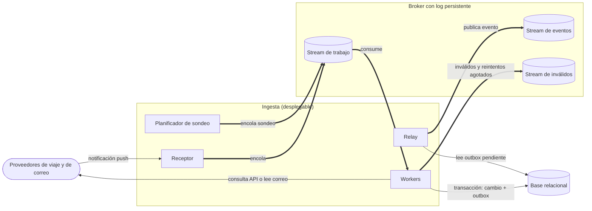
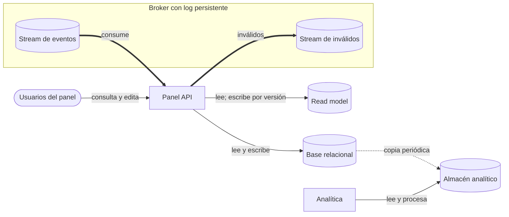

# Iteración 1 de Trotamundos: establecer la estructura general

- Estado: Borrador para revisión
- Fecha: 27/10/2026

---

## Paso 1. Revisar las entradas del diseño

### 1.1 Contexto

Trotamundos unifica los arreglos de viaje en un panel (CU-01). Recibe notificaciones push de los proveedores de viaje y sondea el correo de forma programada (15 M de cuentas, QA-7); traduce ambos a un modelo canónico. El panel tiene 2 M de usuarios activos semanales y picos ×10† (QA-6). Es la primera iteración: no hay iteraciones previas y la estructura general no está fijada. Sus decisiones quedan en ADR-0001 a ADR-0004, hoy en estado Propuesto, más una decisión menor sin ADR (PostgreSQL, Paso 4).

### 1.2 Entradas

| Categoría | Detalle |
|---|---|
| Propósito del diseño | Greenfield. Prototipo en plazo acotado (R-6) |
| Primary functionality | CU-01, CU-02, CU-03 y CU-04. Secundarios: CU-05 a CU-09 (CU-06 se toca por ADR-0004) |
| QA scenarios primarios | Los de prioridad Alta del catálogo. QA-1: actualizaciones de un proveedor en el panel en < 5 min. QA-4: tolerar la caída de una instancia o zona con ≤ 5 min mensuales de inactividad (≈ 99,99 %). QA-6: 15 M de cuentas, 2 M de usuarios activos semanales y picos ×10†, cumpliendo QA-1 y QA-2. QA-8: 99 % de los mensajes válidos procesados y 99 % de los inválidos registrados, sin afectar a otros proveedores |
| Constraints | R-1 a R-6. Condicionan esta iteración R-2 (APIs estándar de los proveedores, sin modificarlas) y R-6 (prototipo rápido en plazo acotado) |
| Concerns | CRN-1 (estructura general), CRN-2 (aprovechar el conocimiento del equipo: Java, PostgreSQL, C++, Python, entre otros), CRN-3 (aislar los casos de uso secundarios) |

† Medida propuesta por el equipo (catálogo de drivers, sección 4).

---

## Paso 2. Establecer el objetivo de la iteración seleccionando drivers

**Objetivo:** Fijar la estructura general de Trotamundos (CRN-1), de modo que la ingesta cubra QA-1 y QA-5 a nivel de decisiones: estilo, desplegables, conector entre ingesta y panel, almacén de lectura del panel y tecnología de la base.

**Tipo:** Un driver importante (CRN-1)

| Driver | Motivo por el que condiciona las decisiones |
|---|---|
| CRN-1* | Fija estilo, desplegables, conector y almacenes |
| QA-1* | Las actualizaciones de proveedores llegan al panel en < 5 min; prioridad y dificultad Altas, y la dificultad está en la ingesta |
| QA-5* | Con la API de un proveedor caída, el panel muestra la última versión conocida y, dentro de 5 min† de restablecida, se recupera el 99 % de los eventos generados durante la caída |
| QA-2 | El panel responde en < 800 ms con carga normal |
| QA-6 | 15 M de cuentas, 2 M de usuarios semanales y picos ×10† cumpliendo QA-1 y QA-2: exige separar las lecturas del panel de las escrituras de la ingesta |
| QA-7 | El correo de usuarios con viajes próximos se procesa en ≤ 15 min† para el 95 %†: condiciona planificador y workers |
| QA-8 | 99 % de los mensajes válidos procesados y 99 % de los inválidos registrados sin afectar a otros proveedores: condiciona el aislamiento por adaptador |
| R-6 | La viabilidad en un plazo acotado es criterio de primer orden |
| CRN-2 | Fija PostgreSQL como tecnología de la base |
| CRN-3 | La analítica (CU-05) va en un desplegable propio, aislada del sistema operativo |
| CU-01 a CU-04 | Flujos de ingesta y panel que la estructura debe soportar |

---

## Paso 3. Elegir uno o más elementos del sistema para refinar

- **Elementos seleccionados:** El sistema Trotamundos completo (diagrama de contexto).
- **Tipo de refinamiento:** Descomposición (top-down)
- **Límite y fuera de alcance:** Se descompone en tres desplegables (Panel API, Ingesta y Analítica) y cuatro piezas de apoyo (base relacional, read model, broker y almacén analítico), con los roles internos de la Ingesta; el diseño interno de cada desplegable más allá de capas y puertos queda fuera. También quedan fuera la partición de la base operacional, el almacén analítico y la copia hacia él, el pipeline de correo y el planificador de sondeo, el despliegue, la seguridad, el diseño interno de la analítica, el dimensionamiento y las réplicas del read model, y compartir entre regiones (<PENDIENTE: iteración donde se trata cada uno>); la tecnología concreta del broker se trata en ADR-0003. QA-3, QA-4, QA-11, QA-12, R-2 y CU-06 se tocan por los ADR sin ser objetivo; el resto de los drivers queda sin tratar (Kanban, 7.2).

---

## Paso 4. Elegir conceptos de diseño y registrar las decisiones

### 4.1 Decisiones

| Decisión | Tipo | Drivers | ADR | Descartadas | Justificación (solo si es menor) |
|---|---|---|---|---|---|
| C-lite: capas/hexagonal con tres desplegables | Patrón | QA-1, QA-2, QA-5, QA-6, QA-7, QA-8, R-2, R-6, CRN-1, CRN-3 | ADR-0001 | Capas / N-tier, Monolito modular, Microservicios | — |
| Broker con log persistente | Patrón | QA-1, QA-4, QA-5, QA-6, QA-7, R-6 | ADR-0003 | Base de datos como bus, Cola durable simple, Plataforma de streaming completa | — |
| Workers asíncronos con outbox transaccional | Patrón | QA-1, QA-5, QA-6, QA-7, QA-8, QA-12, R-2, R-6 | ADR-0002 | Procesar en el receptor, Doble escritura sin outbox, Outbox con CDC | — |
| CQRS en el panel con read model en una instancia de base propia | Patrón | QA-1, QA-2, QA-3, QA-4, QA-6, QA-11, R-6, CRN-2 | ADR-0004 | Sin read model, Tablas de lectura en la misma base operacional, Almacén en memoria | — |
| Aislamiento por adaptador: circuit breaker, reintentos con backoff y cola de mensajes inválidos | Táctica | QA-5, QA-6, QA-7, QA-8, R-2 | ADR-0002 y ADR-0003 | Sin alternativas registradas | — |
| PostgreSQL (base relacional y read model) | Tecnología | CRN-2 | menor | Sin alternativas registradas | Es la tecnología que el equipo conoce (CRN-2). |

### 4.2 Cómo se combinan

Los conceptos forman una cadena: receptor, trabajo, outbox, eventos y read model. Su costo conjunto es el retraso acumulado contra los 5 minutos de QA-1 (BR-1) y la base operacional compartida entre Panel API y Workers (W-2, RM-1); ambos se recogen en CRN-4 y CRN-5.

---

## Paso 5. Instanciar elementos, asignar responsabilidades y definir interfaces

| Elemento | Responsabilidad (una frase) | Tecnología | Se comunica con (mecanismo) |
|---|---|---|---|
| Panel API | Atiende el panel, verifica la lista de personas de un itinerario compartido y mantiene el read model a partir de los eventos. | PENDIENTE: lenguaje y framework (CRN-2) | Usuarios del panel (HTTP); Base relacional (SQL); Read model (puerto); Broker con log persistente (mensajes) |
| Ingesta | Agrupa Receptor, Planificador de sondeo, Workers y Relay, que corren y escalan por separado. | PENDIENTE: lenguaje y framework (CRN-2) | Sus roles |
| Receptor | Recibe el push y lo encola; responde con error si el broker no está, para que el proveedor reintente. | Como Ingesta | Proveedores de viaje y de correo (push); Broker con log persistente (mensajes) |
| Planificador de sondeo | Dispara el sondeo programado del correo (diseño fuera de alcance, Paso 3). | Como Ingesta | Broker con log persistente (mensajes) |
| Workers | Traducen al modelo canónico con un adaptador aislado por proveedor y medio, guardan cambio y evento en una transacción y reconcilian al volver el proveedor. | Como Ingesta | Broker con log persistente (mensajes); Proveedores de viaje y de correo (API o casilla); Base relacional (SQL) |
| Relay | Publica por polling los eventos pendientes del outbox, al menos una vez. | Como Ingesta | Base relacional (SQL); Broker con log persistente (mensajes) |
| Analítica | Procesa datos sobre su almacén propio, sin acceso a la base operacional ni al log. | PENDIENTE: lenguaje y framework (CRN-2) | Almacén analítico |
| Base relacional | Es la fuente de verdad: itinerarios, cambios y outbox. | PostgreSQL | Panel API, Workers y Relay |
| Read model | Guarda un documento por viaje e índice por usuario en una instancia propia, reconstruible desde la base relacional. | PostgreSQL | Panel API |
| Broker con log persistente | Aloja los streams de trabajo, eventos e inválidos con offset por consumidor; no es fuente de verdad. | PENDIENTE: ADR-0003 | Receptor, Planificador de sondeo, Workers, Relay y Panel API |
| Almacén analítico | Guarda los datos de la analítica, alimentados con una copia periódica de la base. | PENDIENTE: fuera de alcance (Paso 3) | Analítica; Base relacional (copia) |
| Proveedores de viaje y de correo | Los de viaje envían push y exponen una API; los de correo exponen casillas. | — (externo) | Receptor; Workers |
| Usuarios del panel | Consultan, editan (CU-04) y comparten itinerarios (CU-06). | — (externo) | Panel API |

**Interfaces:**

- Puerto de mensajería · publicar y consumir en un stream: al menos una vez y consumidores idempotentes; orden por clave (el viaje en eventos; en trabajo, a definir), sin orden global; inválidos y reintentos agotados van al stream de inválidos.
- Workers → Base relacional · guardar cambio y evento: una transacción, idempotente por identificador de notificación o versión del proveedor.
- Puerto del read model · reemplazar documento y borrar entradas: reemplaza solo si la versión nueva es mayor o igual a la guardada (atómico); borra las entradas afectadas ante un cambio de permisos; si falta una, se reconstruye desde la base relacional.
- Pendientes: modelo canónico, contratos del push y de la API o casillas de los proveedores, y API externa del Panel API (<PENDIENTE: iteración donde se definen>); clave de orden y retención del stream de trabajo (ADR-0003); contrato de la copia hacia el almacén analítico (CRN-8).

---

## Paso 6. Esbozar vistas

**Vista: Ingesta**

- Tipo de vista: Component & Connector
- Qué muestra: Cómo entran las notificaciones y el sondeo, se procesan y se publican como eventos.

Diagrama:

Clave:

- Óvalo: actor externo. Rectángulo: elemento de software (rol de la Ingesta). Cilindro: almacén o stream del log.
- Recuadro con título: desplegable (Ingesta) o conector (Broker con log persistente).
- Flecha fina: llamada o acceso directo. Flecha gruesa: mensaje asíncrono por el broker.

**Vista: Panel y almacenes**

- Tipo de vista: Component & Connector
- Qué muestra: Cómo el Panel API consume los eventos, sirve al usuario y se apoya en la base, el read model y el almacén analítico.

Diagrama:

Clave:

- Óvalo: actor externo. Rectángulo: desplegable (Panel API, Analítica). Cilindro: almacén o stream del log.
- Recuadro con título: conector (Broker con log persistente).
- Flecha fina: llamada o acceso directo. Flecha gruesa: mensaje asíncrono por el broker. Flecha punteada: copia periódica.

---

## Paso 7. Analizar el diseño y revisar el objetivo y el propósito del diseño

### 7.1 Concerns nuevas

| ID | Concern | Riesgos de origen | Mitigación prevista |
|---|---|---|---|
| CRN-4 | Las medidas de latencia no están verificadas bajo carga: la cadena receptor, trabajo, outbox, eventos y read model suma retrasos contra los 5 minutos de QA-1 (15 en el correo, QA-7), y el read model en disco debe sostener los picos ×10 de QA-2 y QA-3 | BR-1, W-3, RM-1, RM-2 | Presupuesto por etapa; alertas por retraso de consumo y por antigüedad de la fila más vieja del outbox; prueba de carga con picos ×10; caché en memoria delante del read model si no alcanza (ADR-0004) |
| CRN-5 | Los límites internos se sostienen por disciplina y no por separación física: base operacional compartida, adaptadores en un mismo proceso y capas | W-1, W-2, ES-2, ES-3 (base compartida) | Colas, pools y circuit breaker por adaptador; reglas de dependencia en CI; cada módulo dueño de sus tablas; read model separado; prueba de carga |
| CRN-6 | La ingesta depende del broker y del proveedor para no perder datos: el broker está en el camino de entrada, el log no recupera lo que el proveedor nunca entregó y su ventaja sobre una cola depende de usar el replay | BR-2, BR-3, BR-4 | Broker gestionado o clusterizado y multi-AZ; error al proveedor para que reintente; reconciliación de los adaptadores (ADR-0002); el puerto de mensajería permite pasar a una cola durable |
| CRN-7 | El read model puede servir datos pisados o con permisos desactualizados | RM-3, RM-4 | Escritura condicional por versión; borrar la entrada ante un cambio de permisos, con reintentos; verificar la lista en cada acceso y registrar los rechazos |
| CRN-8 | La copia periódica hacia el almacén analítico no tiene elemento responsable: la analítica no accede a la base operacional (CRN-3) y la copia sale de ella | ES-3 (tramo de la copia) | Asignar la copia a un elemento y definir si lee de una réplica o en ventanas controladas |

Los IDs son provisionales y continúan el catálogo (último: CRN-3).

### 7.2 Kanban al cierre

| Not Yet Addressed | Partially Addressed | Completely Addressed |
|---|---|---|
| CU-05, CU-07, CU-08, CU-09, QA-9, QA-10, R-1, R-3, R-4, R-5, CRN-4, CRN-5, CRN-6, CRN-7, CRN-8 | CU-01, CU-02, CU-03, CU-04, CU-06, QA-1, QA-2, QA-3, QA-4, QA-5, QA-6, QA-7, QA-8, QA-11, QA-12, R-2, R-6, CRN-2, CRN-3 | CRN-1 |

### 7.3 Evaluación y resultado

- **¿Se alcanzó el objetivo del Paso 2?** Sí. La estructura general quedó fijada (ADR-0001 a ADR-0004 y Paso 4) y QA-1 y QA-5 cuentan con buffer, replay y outbox a nivel de decisiones. Sus medidas no están verificadas, por eso quedan en Parcial.
- **Resultado:** Trotamundos queda estructurado en tres desplegables (Panel API, Ingesta y Analítica), con broker de log persistente, workers con outbox y un read model en una instancia PostgreSQL propia para el panel (ADR-0001 a ADR-0004); la base se fija en PostgreSQL por ser la tecnología que el equipo conoce. CRN-1 queda Abordado y el resto de los drivers tocados en Parcial. Quedan sin verificar QA-1, QA-5 y los picos del panel, y sin definir el modelo canónico y las interfaces externas.
