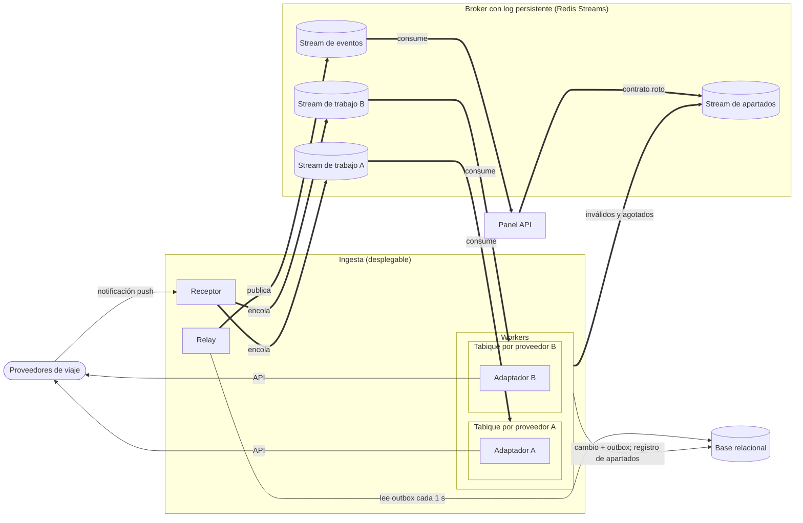
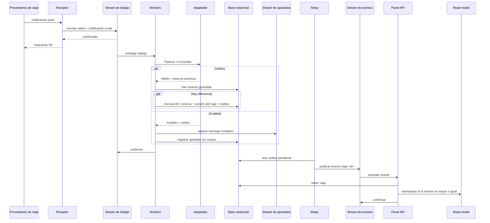
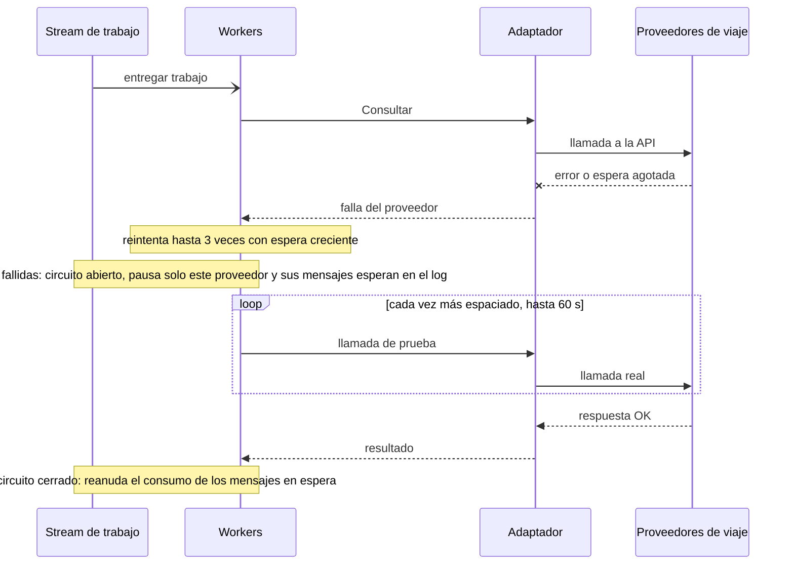

# Iteración 2 de Trotamundos: ingesta de notificaciones de proveedores de punta a punta

- Estado: Borrador para revisión
- Fecha: 27/10/2026

---

## Paso 1. Revisar las entradas del diseño

### 1.1 Contexto

Trotamundos unifica los arreglos de viaje en un panel (CU-01). La Iteración 1 fijó la estructura general: tres desplegables (Panel API, Ingesta y Analítica), broker con log persistente, workers con outbox transaccional y read model en una instancia PostgreSQL propia (ADR-0001 a ADR-0004, más PostgreSQL como decisión menor). Quedaron abiertos el modelo canónico, el contrato de los mensajes, el aislamiento por proveedor y la tecnología del broker. Esta iteración refina la Ingesta, el broker y la base relacional; sus decisiones quedan en ADR-0005 a ADR-0007 y en siete decisiones menores (Paso 4).

### 1.2 Entradas

| Not Yet Addressed | Partially Addressed | Completely Addressed |
|---|---|---|
| CU-05, CU-07, CU-08, CU-09, QA-9, QA-10, R-1, R-3, R-4, R-5, CRN-4, CRN-5, CRN-6, CRN-7, CRN-8 | CU-01, CU-02, CU-03, CU-04, CU-06, QA-1, QA-2, QA-3, QA-4, QA-5, QA-6, QA-7, QA-8, QA-11, QA-12, R-2, R-6, CRN-2, CRN-3 | CRN-1 |

Drivers nuevos desde la iteración anterior:

- CRN-9: las entregas repetidas (caída tras procesar, republicación del relay, reintento del proveedor) no deben duplicar efectos en la base, el log ni el read model.

---

## Paso 2. Establecer el objetivo de la iteración seleccionando drivers

**Objetivo:** Al cerrar la iteración, una notificación de un proveedor de viaje tiene definido su camino de punta a punta (CU-02): representación de la reserva, traducción y validación, contenido de cada mensaje, idempotencia y aislamiento de la falla de un proveedor, con QA-8 y QA-12 medibles con proveedores simulados.

**Tipo:** Drivers relacionados (CU + QA)

| Driver | Motivo por el que condiciona las decisiones |
|---|---|
| CU-02* | Es el camino de la notificación de un proveedor hasta el panel, el que esta iteración define |
| QA-8* | 99 % de los mensajes válidos procesados y 99 % de los inválidos registrados, sin afectar a otros proveedores: exige un criterio objetivo de validez con motivo |
| QA-12* | Un tipo o medio nuevo no debe modificar el núcleo: condiciona el modelo canónico y el contrato del adaptador |
| CRN-5* | La falla de un adaptador o proveedor debe quedar acotada sin un desplegable propio |
| CRN-9* | La entrega al menos una vez obliga a que cada consumidor sea idempotente |
| QA-1 | Actualizaciones en el panel en < 5 min: reintentos y circuito consumen ese presupuesto |
| QA-5 | Recuperar el 99 % de los eventos dentro de 5 min de restablecido el proveedor: condiciona el tope del circuito y la retención |
| R-2 | Los adaptadores se ajustan a los contratos de los proveedores sin modificarlos |
| R-3 | Los límites de uso de cada proveedor se respetan |
| R-4 | El log y los apartados retienen pocos datos personales y por tiempo acotado |
| R-6 | Prototipo en plazo acotado: limita las piezas y tecnologías nuevas |
| CU-01, CU-03, CU-04 | El panel consume los eventos; el correo usa el mismo adaptador y sobre; el alta manual usa la misma validación |

---

## Paso 3. Elegir uno o más elementos del sistema para refinar

- **Elementos seleccionados:** Ingesta (Receptor, Workers y Relay), Broker con log persistente y Base relacional.
- **Tipo de refinamiento:** Descomposición (top-down)
- **Límite y fuera de alcance:** Se definen los adaptadores dentro de los Workers, los streams del broker y su tecnología, y lo que la base guarda de reservas y apartados. Quedan fuera el pipeline de correo y el planificador (CU-03, QA-7, QA-9, QA-10; Iteración 3), los mapeos concretos por proveedor, las tablas de la base, y la alta disponibilidad y el monitoreo (Iteración 5). CRN-2, CRN-4, CRN-6 y QA-6 se tocan sin ser objetivo.

---

## Paso 4. Elegir conceptos de diseño y registrar las decisiones

### 4.1 Decisiones

| Decisión | Tipo | Drivers | ADR | Descartadas | Justificación (solo si es menor) |
|---|---|---|---|---|---|
| Modelo canónico de núcleo y detalle versionado, con adaptador de tres operaciones por proveedor y medio | Patrón | CU-02, CU-03, CU-04, QA-8, QA-12, R-2, R-3, R-6, CRN-5 | ADR-0005 | Modelo plano único, Sin modelo canónico, Estándar sectorial como modelo interno | — |
| Sobre común versionado con idempotencia en cada consumidor | Patrón | CU-01, CU-02, CU-03, QA-1, QA-5, QA-8, QA-12, R-2, R-4, R-6, CRN-9 | ADR-0006 | Evento con el estado completo, Notificación interpretada en el receptor, Deduplicación por identificador | — |
| Tabiques por proveedor con circuit breaker y stream de apartados | Táctica | CU-02, CU-03, QA-1, QA-5, QA-8, R-3, R-4, R-6, CRN-5 | ADR-0007 | Pool compartido sin apartar, Breaker sobre stream común, Apartados completos en la BD | — |
| Redis Streams en instancia dedicada, con `noeviction` y persistencia antes de confirmar | Tecnología | QA-1, QA-5, R-6, CRN-2, CRN-6 | menor | RabbitMQ Streams (queda como evolución detrás del puerto) | Suma una sola tecnología nueva (R-6), trae contador de entregas nativo y queda detrás del puerto de mensajería. |
| Retención por stream: 48 h trabajo de proveedores, 24 h eventos, 7 días apartados\* | Táctica | QA-5, QA-6, R-4 | menor | Sin alternativas registradas | Se deriva del tiempo de recuperación tras la caída de un proveedor (QA-5) y de la memoria disponible del broker. |
| Mensajes en JSON con esquemas en el repositorio | Tecnología | QA-12, R-6 | menor | Avro o Protobuf con registro de esquemas | Es reversible porque el sobre lleva `versionContrato`. |
| Evento mínimo con solo referencias | Táctica | R-4, QA-6 | menor | Evento con el estado completo | Es reversible agregando un campo opcional `estado`. |
| Registro de apartados con metadatos, sin el cuerpo y con motivos cerrados | Táctica | QA-8, R-4 | menor | Sin alternativas registradas | No guarda datos personales en la BD (R-4) y permite medir QA-8 por motivo. |
| Parámetros de resiliencia: 3 reintentos ante falla del proveedor, 5 entregas ante error propio, circuito abierto con la mitad de 20 llamadas fallidas, tope de prueba de 60 s, recorte y alertas de memoria del broker\* | Táctica | QA-1, QA-5, CRN-5, CRN-6 | menor | Sin alternativas registradas | Son propuestas para el prototipo que se ajustan con proveedores simulados; el tope de 60 s deja 4 de los 5 min de QA-5. |
| Relay cada 1 s con relectura inmediata si el lote vino lleno\* | Táctica | QA-1, QA-6 | menor | Sin alternativas registradas | Quedaba pendiente del ADR-0002 y 1 s es despreciable frente a los 5 min de QA-1. |

\* Valores propuestos para el prototipo; se ajustan con proveedores simulados y prueba de carga.

### 4.2 Cómo se combinan

El adaptador clasifica cada resultado (válido, inválido o falla del proveedor), y esa clasificación decide qué aparta el contrato de mensajes y qué pausa el circuito. El costo conjunto es que reintentos, circuito, arriendos por partición y validación por esquema dependen de código y parámetros propios que consumen el presupuesto de QA-1; se recoge en CRN-4 y CRN-5.

---

## Paso 5. Instanciar elementos, asignar responsabilidades y definir interfaces

Los elementos de la Iteración 1 que no figuran no cambian.

| Elemento | Responsabilidad (una frase) | Tecnología | Se comunica con (mecanismo) |
|---|---|---|---|
| Receptor | Arma el mensaje de trabajo con el sobre y la notificación cruda, sin interpretarla, y responde al proveedor solo cuando el broker confirma. | Como Ingesta | Proveedores de viaje (push); Stream de trabajo (mensajes) |
| Workers | Procesan el trabajo de cada proveedor dentro de su tabique y guardan la reserva solo si difiere de la guardada. | Como Ingesta | Stream de trabajo y Stream de apartados (mensajes); Adaptador (llamada en proceso); Base relacional (SQL) |
| Tabique por proveedor | Da a cada proveedor su pool de conexiones, límite de concurrencia, limitador de tasa y circuit breaker. | Como Ingesta | Parte de los Workers |
| Adaptador | Traduce y valida lo que envía un proveedor y medio, sin escribir, publicar ni reintentar. | Como Ingesta | Workers (llamada en proceso); Proveedores de viaje (API) |
| Relay | Publica los eventos pendientes del outbox cada 1 s y relee en el acto si el lote vino lleno. | Como Ingesta | Base relacional (SQL); Stream de eventos (mensajes) |
| Broker con log persistente | Aloja los streams de trabajo por proveedor, de eventos y de apartados con retención por stream; no es fuente de verdad. | Redis Streams, instancia dedicada | Receptor, Workers, Relay y Panel API |
| Stream de trabajo | Guarda los mensajes de trabajo particionados por proveedor (`trabajo:<proveedor>:<n>`), con un consumidor activo por partición. | Redis Streams | Receptor; Workers |
| Stream de eventos | Guarda los eventos con clave `viaje:<id del viaje>`. | Redis Streams | Relay; Panel API |
| Stream de apartados | Guarda completos los mensajes inválidos, de contrato roto o agotados (reemplaza al «stream de inválidos» de la Iteración 1). | Redis Streams | Workers; Panel API |
| Base relacional | Guarda la reserva canónica (núcleo y detalle por tipo), la versión del viaje, el outbox y el registro de apartados. | PostgreSQL | Workers, Relay y Panel API |
| Panel API | Al recibir un evento relee el viaje y actualiza el read model; valida las reservas manuales con los mismos esquemas. | PENDIENTE: lenguaje y framework (CRN-2) | Stream de eventos (mensajes); Base relacional (SQL); Read model (puerto) |

**Interfaces:**

- Adaptador · *Traducir*: notificación cruda → *Válido* con la reserva canónica, o *Inválido* con motivo (estructura, campo obligatorio, invariante, tipo no soportado); un error de red, una espera agotada o un error del proveedor es falla del proveedor, no inválido.
- Adaptador · *Consultar*: reserva del proveedor → su estado actual, con el mismo resultado que *Traducir*.
- Adaptador · *Describir*: <PENDIENTE: qué devuelve; el ADR-0005 no lo detalla>.
- Mensaje de trabajo · stream `trabajo:<proveedor>:<n>`: sobre (`idMensaje`, `versionContrato`, `claveDeOrden` = `<proveedor>:<id externo>`, `horaDelHecho`, `correlacion`, `origen` = `<proveedor>/<medio>`) y la notificación cruda.
- Evento · stream de eventos, clave `viaje:<id del viaje>`: sobre más `tipoEvento`, `idViaje`, `idReserva` y `versionViaje`; un `tipoEvento` desconocido se trata como «el viaje cambió»; un sobre incompleto o de versión desconocida se aparta con motivo «contrato».
- Apartado · stream de apartados: el mensaje completo. Registro en la base: `idMensaje` (único), `origen`, `claveDeOrden`, `correlacion`, motivo, intentos, hora y estado. El reproceso republica con el mismo `idMensaje`.
- Workers → Base relacional · guardar cambio y evento: una transacción (reserva, versión del viaje y outbox) solo si la reserva traducida difiere de la guardada; idempotente por la clave única proveedor e identificador externo. Reemplaza la idempotencia «por identificador de notificación o versión del proveedor» de la Iteración 1 (ADR-0006).
- Todo consumidor confirma el mensaje solo después de completar su efecto.
- Pendientes: contratos del push y de la API de cada proveedor y sus mapeos (<PENDIENTE: iteración>); mensaje y retención del trabajo de correo (Iteración 3); API externa del Panel API (Iteración 4); copia hacia el almacén analítico (CRN-8, Iteración 5).

---

## Paso 6. Esbozar vistas

**Vista: Ingesta por proveedor**

- Tipo de vista: Component & Connector
- Qué muestra: Cómo cada proveedor tiene su stream, tabique y adaptador, y adónde va cada resultado.

Diagrama:

Clave:

- Óvalo: actor externo. Rectángulo: elemento de software. Cilindro: almacén o stream del log.
- Recuadro con título: desplegable (Ingesta), agrupación de roles (Workers), elemento compuesto (Tabique por proveedor, que contiene a su adaptador) o conector (Broker con log persistente).
- Flecha fina: llamada o acceso directo. Flecha gruesa: mensaje asíncrono por el broker.
- A y B representan a cualquier proveedor; hay un tabique y un adaptador por proveedor y medio.
- El adaptador corre dentro del tabique de su proveedor (llamada en proceso *Traducir / Consultar*). Las flechas hacia la base y el stream de apartados salen de los Workers, sin distinguir el tabique de origen.

**Vista: Notificación de punta a punta**

- Tipo de vista: Secuencia
- Qué muestra: El recorrido de una notificación válida o inválida hasta el panel (CU-02), del que salen las interfaces internas del Paso 5.

Diagrama:

Clave:

- Columna: elemento del Paso 5. Flecha sólida: llamada sincrónica. Flecha punteada: respuesta. Flecha abierta: entrega asíncrona por el broker.
- `alt`: caminos excluyentes. `opt`: paso que ocurre solo si se cumple la condición.

**Vista: Falla de un proveedor**

- Tipo de vista: Secuencia
- Qué muestra: Cómo el circuit breaker pausa solo el consumo del proveedor caído y cómo se reanuda.

Diagrama:

Clave:

- Columna: elemento del Paso 5. Flecha sólida: llamada sincrónica. Flecha punteada: respuesta. Flecha con cruz: llamada fallida. Flecha abierta: entrega asíncrona por el broker.
- `loop`: repetición. Nota: cambio de estado del circuit breaker.

---

## Paso 7. Analizar el diseño y revisar el objetivo y el propósito del diseño

### 7.1 Concerns nuevas

| ID | Concern | Riesgos de origen | Mitigación prevista |
|---|---|---|---|
| CRN-10 | Contratos, esquemas, adaptadores y validación pueden desalinearse o deformar datos al normalizar | MC-1, MC-2, MC-3, MC-4, MC-5 | Una sola fuente de esquemas compartida con el Panel API; pruebas de contrato por adaptador con mensajes de muestra; bloque de extensión; lector tolerante; versión nueva que convive con la anterior; revisión periódica de motivos por proveedor |

Los IDs son provisionales y continúan el catálogo (último: CRN-9).

**Riesgos de las decisiones menores** (sin ADR):

| ID | Riesgo | Mitigación |
|---|---|---|
| BK-1 | La memoria del broker limita cuánto retiene el log; si se llena, el receptor rechaza notificaciones (QA-5, QA-6) | Retención por stream, recorte y alertas de memoria; el proveedor reintenta ante el error |
| BK-2 | Persistir antes de confirmar no alcanza si se pierde la instancia del broker (QA-5) | Espera de réplica en producción y medición en la prueba de carga |
| BK-3 | El consumidor único por partición se sostiene con arriendos en código propio (CRN-9) | Pruebas de caída de workers y de reclamo de pendientes |
| BK-4 | El equipo no tiene experiencia con Redis (CRN-2, R-6) | Prueba temprana del broker con caídas y reentregas; el puerto permite pasar a RabbitMQ Streams |

**Riesgos que se suman a drivers existentes:**

| Driver | Riesgos |
|---|---|
| CRN-2 | BK-4 |
| CRN-4 | MS-4, RS-2 (demoras contra los 5 min de QA-1) |
| CRN-5 | RS-1, MS-1 (resiliencia con código propio y lecturas sobre la base compartida) |
| CRN-6 | BK-1, BK-2 |
| CRN-9 | MS-3, MS-5, RS-3, BK-3 |
| R-4 | MS-2 (notificación cruda con datos personales en el log) |

### 7.2 Kanban al cierre

| Not Yet Addressed | Partially Addressed | Completely Addressed |
|---|---|---|
| CU-05, CU-07, CU-08, CU-09, QA-9, QA-10, R-1, R-5, CRN-7, CRN-8, CRN-10 | CU-01, CU-02, CU-03, CU-04, CU-06, QA-1, QA-2, QA-3, QA-4, QA-5, QA-6, QA-7, QA-8, QA-11, QA-12, R-3, R-4, R-6, CRN-2, CRN-3, CRN-4, CRN-5, CRN-6, CRN-9 | CRN-1, R-2 |

### 7.3 Evaluación y resultado

- **¿Se alcanzó el objetivo del Paso 2?** Sí. El camino de CU-02 quedó definido de punta a punta (ADR-0005 a 0007 y decisiones menores, vistas del Paso 6) y QA-8 y QA-12 son medibles con proveedores simulados. Sus medidas no están verificadas, por eso siguen en Parcial.

| Driver | Cambio | Evidencia | Falta |
|---|---|---|---|
| R-2 | Parcial → Abordado | Adaptador por proveedor y medio que traduce el contrato ajeno sin modificarlo (ADR-0005) | Mapeos concretos, que no cambian la estructura |
| R-3 | No abordado → Parcial | Limitador de tasa por tabique y respeto del 429 (ADR-0007) | Límites reales de cada proveedor |
| R-4 | No abordado → Parcial | Evento sin datos de reserva, apartados sin cuerpo en la BD y retención por stream | Datos personales en la notificación cruda (MS-2) |
| CRN-4 | No abordado → Parcial | `horaDelHecho` y `correlacion` permiten medir la demora por etapa (ADR-0006); relay de 1 s | Prueba de carga |
| CRN-5 | No abordado → Parcial | Tabiques y circuit breaker por proveedor (ADR-0007) | Base compartida, RS-1 y MS-1 |
| CRN-6 | No abordado → Parcial | Broker sin expulsión que persiste antes de confirmar; el receptor responde con error si no puede encolar | BK-1 y BK-2 |
| CRN-9 | Nuevo → Parcial | Clave única, comparación con lo guardado y escritura por versión (ADR-0006) | Pruebas de reentrega (MS-3, MS-5, RS-3, BK-3) |
| CRN-10 | Nuevo → No abordado | Concern nueva de esta iteración | Mitigaciones del 7.1 |

- **Resultado:** La Ingesta queda descompuesta en Receptor, Workers con un tabique y un adaptador por proveedor y medio, y Relay, sobre Redis Streams con streams de trabajo por proveedor, eventos y apartados. Toda reserva se representa con un núcleo común y un detalle versionado (ADR-0005), los mensajes comparten un sobre y cada consumidor es idempotente (ADR-0006), y la falla de un proveedor queda acotada a su tabique (ADR-0007). Quedan pendientes el pipeline de correo, la verificación de QA-1, QA-5, QA-8 y QA-12 con proveedores simulados, y la alta disponibilidad del broker y la base.
