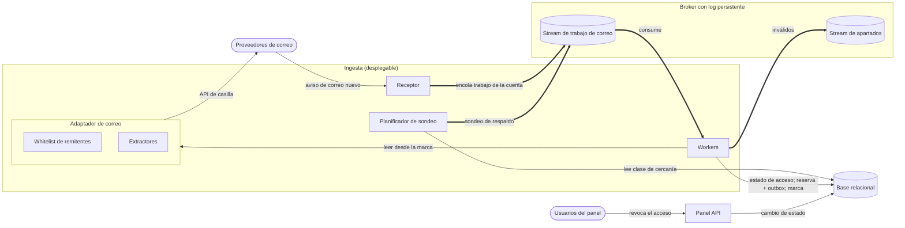
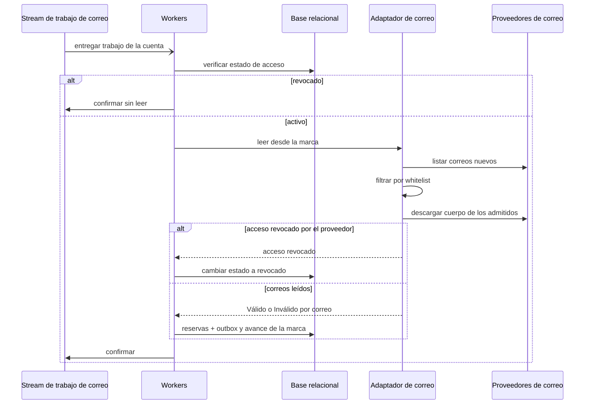

# Iteración 3 de Trotamundos: incorporar reservas desde el correo

- Estado: Borrador para revisión
- Fecha: 27/10/2026

---

## Paso 1. Revisar las entradas del diseño

### 1.1 Contexto

Trotamundos unifica los arreglos de viaje en un panel (CU-01) y su diferencial es incorporar reservas desde el correo del usuario (CU-03). La Iteración 1 fijó la estructura general (ADR-0001 a ADR-0004). La Iteración 2 definió la ingesta de proveedores de viaje: modelo canónico con adaptador por proveedor (ADR-0005), contrato de mensajes con idempotencia (ADR-0006), tabiques con circuit breaker y apartados (ADR-0007) y Redis Streams como broker. El Planificador de sondeo y el trabajo de correo con clave `correo:<id de la cuenta>` ya existen, pero el pipeline de correo quedó fuera de alcance. Esta iteración lo define en ADR-0008 a ADR-0010.

### 1.2 Entradas

| Not Yet Addressed | Partially Addressed | Completely Addressed |
|---|---|---|
| CU-05, CU-07, CU-08, CU-09, QA-9, QA-10, R-1, R-5, CRN-7, CRN-8, CRN-10 | CU-01, CU-02, CU-03, CU-04, CU-06, QA-1, QA-2, QA-3, QA-4, QA-5, QA-6, QA-7, QA-8, QA-11, QA-12, R-3, R-4, R-6, CRN-2, CRN-3, CRN-4, CRN-5, CRN-6, CRN-9 | CRN-1, R-2 |

Drivers nuevos desde la iteración anterior: ninguno.

---

## Paso 2. Establecer el objetivo de la iteración seleccionando drivers

**Objetivo:** Al cerrar la iteración, el pipeline de correo (CU-03) tiene definido cómo detecta el correo nuevo, qué lee y conserva, cómo extrae la reserva y cómo corta un acceso revocado, con QA-7, QA-9 y QA-10 medibles con proveedores de correo simulados.

**Tipo:** Drivers relacionados (CU + QA)

| Driver | Motivo por el que condiciona las decisiones |
|---|---|
| CU-03* | Es el pipeline que esta iteración define |
| QA-7* | 95 %\* de los usuarios con viajes próximos con su correo procesado en ≤ 15 min\*, con 15 M de cuentas: condiciona la detección y la planificación |
| QA-9* | 95 %\* de los correos de remitentes en la whitelist extraídos correctamente en < 15 s: condiciona el filtro y la extracción |
| QA-10* | Dejar de leer en < 1 min\* tras la revocación y 0 lecturas posteriores con el token revocado: condiciona el corte del acceso |
| R-4 | El correo es el dato personal más sensible que toca el sistema: limita qué se descarga y qué se conserva |
| R-3 | Los avisos, formatos y límites de uso de los proveedores de correo son condiciones dadas |
| QA-6 | 15 M de cuentas: limita la frecuencia de sondeo y las lecturas por cuenta sobre la base |
| QA-8 | Una revocación no debe contarse como inválido y un formato sin extractor debe registrarse con motivo |
| CRN-9 | Un trabajo repetido no debe perder ni duplicar correos |
| R-6 | Prototipo en plazo acotado: limita las piezas nuevas |
| CU-04, CU-08 | El alta manual cubre lo que no se extrae; la whitelist es el paso de filtrado de CU-08 |

\* Medida propuesta por el equipo (catálogo de drivers, sección 4).

---

## Paso 3. Elegir uno o más elementos del sistema para refinar

- **Elementos seleccionados:** Ingesta (Receptor, Planificador de sondeo, Workers y adaptador de correo), Base relacional y Panel API.
- **Tipo de refinamiento:** Descomposición (top-down)
- **Límite y fuera de alcance:** Se definen la detección, el filtrado, la extracción y la revocación del correo. Quedan fuera la importación de correos anteriores a la conexión (decisión pendiente), las frecuencias por clase, los extractores concretos, y la alta disponibilidad y el monitoreo (Iteración 5). QA-12 y CRN-5 se tocan sin ser objetivo.

---

## Paso 4. Elegir conceptos de diseño y registrar las decisiones

### 4.1 Decisiones

| Decisión | Tipo | Drivers | ADR | Descartadas | Justificación (solo si es menor) |
|---|---|---|---|---|---|
| Revocación como cambio de estado atómico verificado antes de cada lectura, con resultado «acceso revocado» | Táctica | CU-03, QA-10, QA-8, R-4, R-6, CRN-5 | ADR-0008 | Purgar el log, Esperar el vencimiento del token, Contarla como falla del proveedor | — |
| Whitelist global antes de descargar el cuerpo, correo en memoria sin conservar y extractor declarativo por remitente y formato | Táctica | CU-03, CU-08, QA-7, QA-8, QA-9, QA-12, R-4, R-6 | ADR-0009 | Leer todo y filtrar por contenido, Conservar el correo, Modelo de lenguaje | — |
| Aviso push con sondeo de respaldo por clases de cercanía y marca incremental por cuenta | Táctica | CU-03, QA-6, QA-7, R-3, R-6, CRN-9 | ADR-0010 | Solo sondeo, Solo aviso push, Sondeo uniforme | — |

### 4.2 Cómo se combinan

Las tres decisiones operan sobre el mismo trabajo de la cuenta. El aviso o el planificador lo encolan (ADR-0010), el worker verifica el estado de acceso (ADR-0008) y lee desde la marca solo los remitentes de la whitelist, con extracción en memoria (ADR-0009). El costo conjunto es que cada trabajo suma lecturas y escrituras en la base compartida (estado de acceso y marca), además de la casilla; se recoge en CRN-5.

---

## Paso 5. Instanciar elementos, asignar responsabilidades y definir interfaces

Los elementos de las iteraciones anteriores que no figuran no cambian.

| Elemento | Responsabilidad (una frase) | Tecnología | Se comunica con (mecanismo) |
|---|---|---|---|
| Receptor | Además del push de viaje, recibe el aviso de correo nuevo y encola el trabajo de la cuenta. | Como Ingesta | Proveedores de correo (push); Stream de trabajo de correo (mensajes) |
| Planificador de sondeo | Emite el sondeo de respaldo según la clase de cercanía del viaje de cada cuenta, con un trabajo pendiente por cuenta y frenando ante el atraso. | Como Ingesta | Base relacional (SQL); Stream de trabajo de correo (mensajes) |
| Workers | Verifican el estado de acceso antes de cada lectura, leen la casilla desde la marca y la avanzan solo después de procesar. | Como Ingesta | Stream de trabajo de correo (mensajes); Adaptador de correo (llamada en proceso); Base relacional (SQL) |
| Adaptador de correo | Descarga solo los correos de remitentes en la whitelist y les aplica su extractor, en memoria. | Como Ingesta | Workers (llamada en proceso); Proveedores de correo (API de casilla) |
| Whitelist de remitentes | Lista global de remitentes admitidos, con el mismo identificador de proveedor que los adaptadores. | Configuración | Adaptador de correo |
| Extractores | Describen cómo obtener la reserva de los correos de un remitente y formato. | PENDIENTE: formato declarativo | Adaptador de correo |
| Base relacional | Guarda además el estado de acceso y la marca de sincronización de cada cuenta. | PostgreSQL | Panel API, Workers y Planificador de sondeo |
| Panel API | Registra la revocación del usuario como un cambio de estado atómico. | PENDIENTE: lenguaje y framework (CRN-2) | Base relacional (SQL) |
| Proveedores de correo | Envían avisos de correo nuevo y exponen las casillas. | — (externo) | Receptor; Adaptador de correo |

**Interfaces:**

- Trabajo de correo · stream de trabajo de correo, clave `correo:<id de la cuenta>`: sobre del ADR-0006, sin contenido de correo ni tokens; el aviso y el sondeo encolan el mismo trabajo.
- Adaptador de correo · leer la casilla desde la marca: cuenta y marca → por cada correo de un remitente admitido, *Válido* con la reserva o *Inválido* con motivo (incluido «formato no soportado»); o «acceso revocado»; o falla del proveedor.
- Workers → Base relacional · verificar el estado de acceso: antes de cada lectura de la casilla; si está revocado, el trabajo se confirma sin leer ni apartar.
- Workers → Base relacional · avanzar la marca: después de procesar lo leído; un trabajo repetido vuelve a leer desde la marca guardada.
- Panel API → Base relacional · revocar el acceso: cambio de estado en una transacción.

---

## Paso 6. Esbozar vistas

**Vista: Pipeline de correo**

- Tipo de vista: Component & Connector
- Qué muestra: Cómo se detecta, filtra y extrae el correo nuevo y dónde se verifica el acceso.

Diagrama:

Clave:

- Óvalo: actor externo. Rectángulo: elemento de software. Cilindro: almacén o stream del log.
- Recuadro con título: desplegable (Ingesta), elemento compuesto (Adaptador de correo) o conector (Broker con log persistente).
- Flecha fina: llamada o acceso directo. Flecha gruesa: mensaje asíncrono por el broker.

**Vista: Lectura de una casilla**

- Tipo de vista: Secuencia
- Qué muestra: El procesamiento de un trabajo de correo, del que salen las interfaces internas del Paso 5.

Diagrama:

Clave:

- Columna: elemento del Paso 5. Flecha sólida: llamada sincrónica. Flecha punteada: respuesta. Flecha abierta: entrega asíncrona por el broker.
- `alt`: caminos excluyentes. Los inválidos van al stream de apartados como en la Iteración 2 (no se muestra).

---

## Paso 7. Analizar el diseño y revisar el objetivo y el propósito del diseño

### 7.1 Concerns nuevas

| ID | Concern | Riesgos de origen | Mitigación prevista |
|---|---|---|---|
| CRN-11 | El corte del acceso depende de verificaciones en código propio y de clasificar bien las respuestas del proveedor | RV-1, RV-3 | Verificar el estado también antes de guardar el resultado; pruebas de contrato con respuestas de vencimiento y revocación |
| CRN-12 | La cobertura de la extracción depende de una whitelist y extractores mantenidos a mano | EX-1, EX-2, EX-4 | Alerta por salto de «formato no soportado» por remitente; revisión periódica de la whitelist; prioridad por volumen de remitente |
| CRN-13 | La frescura del correo depende de la clase asignada y de avisos que pueden fallar sin error | SO-1, SO-2, SO-4 | Recalcular la clase al cambiar un viaje; emitir primero las clases cercanas; alertas por atraso y por cuentas sin avisos |

Los IDs son provisionales y continúan el catálogo (último: CRN-10).

**Riesgos que se suman a drivers existentes:**

| Driver | Riesgos |
|---|---|
| CU-03 | EX-3, SO-5 (correo borrado antes del reproceso; correos anteriores a la conexión) |
| CRN-5 | RV-2 (lectura del estado de acceso sobre la base compartida) |
| CRN-9 | SO-3 (marca incorrecta) |
| CRN-10 | EX-5 (whitelist y adaptadores desalineados) |
| R-4 | RV-4 (trabajos de cuentas revocadas retenidos en el log) |

### 7.2 Kanban al cierre

| Not Yet Addressed | Partially Addressed | Completely Addressed |
|---|---|---|
| CU-05, CU-07, CU-09, R-1, R-5, CRN-7, CRN-8, CRN-10, CRN-11, CRN-12, CRN-13 | CU-01, CU-02, CU-03, CU-04, CU-06, CU-08, QA-1, QA-2, QA-3, QA-4, QA-5, QA-6, QA-7, QA-8, QA-9, QA-10, QA-11, QA-12, R-3, R-4, R-6, CRN-2, CRN-3, CRN-4, CRN-5, CRN-6, CRN-9 | CRN-1, R-2 |

### 7.3 Evaluación y resultado

- **¿Se alcanzó el objetivo del Paso 2?** Sí. Detección, filtrado, extracción y revocación quedaron definidos (ADR-0008 a 0010, vistas del Paso 6) y QA-7, QA-9 y QA-10 son medibles con proveedores de correo simulados. Sus medidas no están verificadas, por eso quedan en Parcial.

| Driver | Cambio | Evidencia | Falta |
|---|---|---|---|
| CU-08 | No abordado → Parcial | Whitelist global aplicada antes de descargar el cuerpo (ADR-0009) | Contenido de la whitelist y su administración |
| QA-9 | No abordado → Parcial | Extractor declarativo por remitente y formato, en memoria, con motivo «formato no soportado» (ADR-0009) | Medir el 95 % y los 15 s con correos de muestra |
| QA-10 | No abordado → Parcial | Estado de acceso verificado antes de cada lectura y resultado «acceso revocado» (ADR-0008) | Prueba de revocación con lecturas en vuelo |
| QA-7 | Sigue Parcial | Aviso push, sondeo de respaldo por cercanía y freno por atraso (ADR-0010) | Frecuencias por clase y prueba de carga con 15 M de cuentas |
| CRN-11, CRN-12, CRN-13 | Nuevo → No abordado | Concerns nuevas de esta iteración | Mitigaciones del 7.1 |

- **Resultado:** El pipeline de correo queda descompuesto sobre los elementos existentes. El Receptor recibe avisos, el Planificador emite el sondeo de respaldo por cercanía y los Workers verifican el acceso y leen desde una marca por cuenta. El adaptador de correo filtra por whitelist y extrae en memoria con extractores declarativos (ADR-0008 a 0010). Quedan pendientes la importación de correos anteriores y la alta disponibilidad y el monitoreo.
