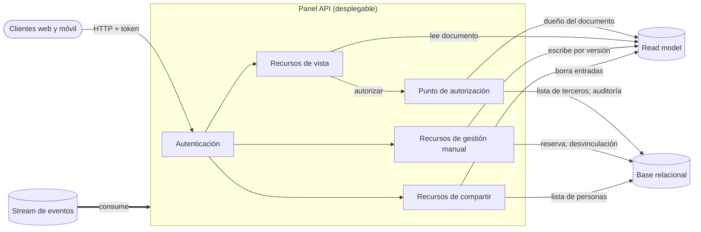
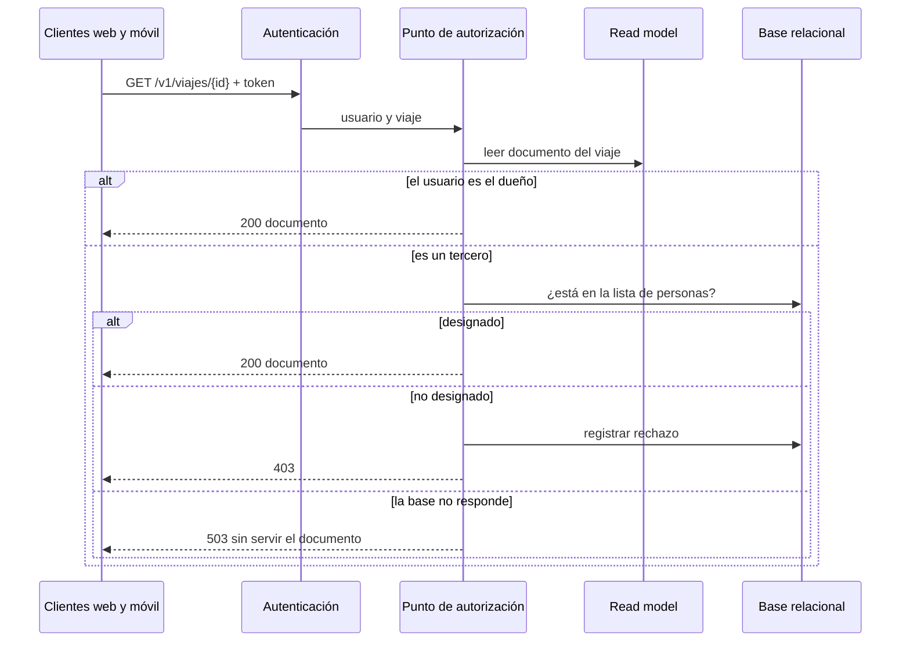
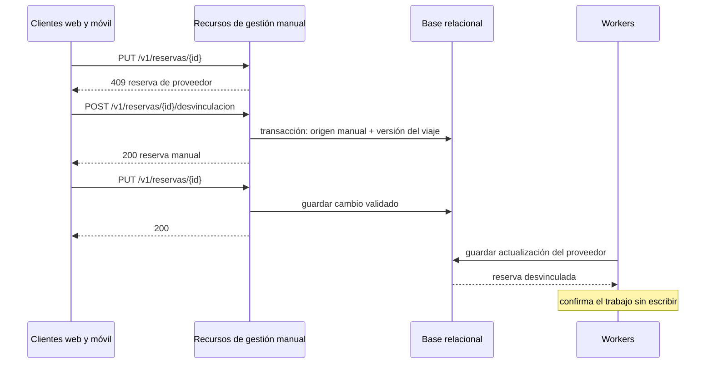

# Iteración 4 de Trotamundos: contrato externo del Panel API

- Estado: Borrador para revisión
- Fecha: 27/10/2026

---

## Paso 1. Revisar las entradas del diseño

### 1.1 Contexto

Trotamundos unifica los arreglos de viaje en un panel (CU-01). La Iteración 1 fijó la estructura general y el read model del panel en una instancia PostgreSQL propia (ADR-0001 a ADR-0004). La Iteración 2 definió la ingesta de proveedores de viaje (ADR-0005 a ADR-0007) y la Iteración 3, el pipeline de correo (ADR-0008 a ADR-0010). El Panel API sigue sin contrato externo, sin lenguaje elegido y sin reglas para la gestión manual y el compartir. Esta iteración los define en ADR-0011 a ADR-0013. El ADR-0012 reemplaza la verificación de la lista de personas sobre el documento del read model que fijaba el ADR-0004.

### 1.2 Entradas

| Not Yet Addressed | Partially Addressed | Completely Addressed |
|---|---|---|
| CU-05, CU-07, CU-09, R-1, R-5, CRN-7, CRN-8, CRN-10, CRN-11, CRN-12, CRN-13 | CU-01, CU-02, CU-03, CU-04, CU-06, CU-08, QA-1, QA-2, QA-3, QA-4, QA-5, QA-6, QA-7, QA-8, QA-9, QA-10, QA-11, QA-12, R-3, R-4, R-6, CRN-2, CRN-3, CRN-4, CRN-5, CRN-6, CRN-9 | CRN-1, R-2 |

Drivers nuevos desde la iteración anterior: ninguno.

---

## Paso 2. Establecer el objetivo de la iteración seleccionando drivers

**Objetivo:** Al cerrar la iteración, el Panel API tiene definido su contrato externo para consultar el panel, gestionar reservas y compartir itinerarios, y QA-2 y QA-11 quedan abordados por análisis.

**Tipo:** Drivers relacionados (CU + QA)

| Driver | Motivo por el que condiciona las decisiones |
|---|---|
| CU-01* | Las vistas del panel son el contrato principal de consulta |
| CU-04* | Alta, modificación y baja de reservas, que pueden competir con las del proveedor |
| CU-06* | Compartir un itinerario define quién puede verlo |
| QA-2* | Respuesta en < 800 ms con carga normal: pide una lectura por vista |
| QA-11* | Rechazar y registrar el 100 % de los accesos no autorizados: pide un punto único que deniegue por defecto |
| CRN-7* | El read model puede servir permisos desactualizados |
| R-1 | Web y móvil deben usar la misma API |
| QA-4 | El panel debe seguir sirviendo con la base relacional caída |
| QA-1 | Las reservas de proveedor deben seguir actualizándose en < 5 min aunque el usuario las edite |
| QA-6 | Una lectura extra por pedido se multiplica por 2 M de usuarios semanales |
| R-4 | Un itinerario compartido expone datos personales a terceros |
| R-6, CRN-2 | Plazo acotado y conocimiento del equipo: limitan estilos y tecnologías de la API |

---

## Paso 3. Elegir uno o más elementos del sistema para refinar

- **Elementos seleccionados:** Panel API y su relación con la Base relacional, el Read model y los Workers.
- **Tipo de refinamiento:** Descomposición (top-down)
- **Límite y fuera de alcance:** Se descompone el Panel API en autenticación, punto de autorización y recursos de vista, gestión manual y compartir. Quedan fuera los clientes web y móvil (QA-3, R-5), la alta disponibilidad de la base y la agrupación de reservas por viaje (CU-07). QA-3, QA-9 y CRN-9 se tocan sin ser objetivo.

---

## Paso 4. Elegir conceptos de diseño y registrar las decisiones

### 4.1 Decisiones

| Decisión | Tipo | Drivers | ADR | Descartadas | Justificación (solo si es menor) |
|---|---|---|---|---|---|
| API REST única para web y móvil, con un recurso por vista del panel | Patrón | CU-01, CU-04, CU-06, QA-2, QA-3, QA-6, R-1, R-6, CRN-2 | ADR-0011 | Backend por cliente, GraphQL, REST por recurso fino | — |
| Punto único de autorización: dueño con el documento, terceros contra la base relacional, denegación por defecto y registro antes de responder | Táctica | CU-01, CU-06, QA-1, QA-2, QA-4, QA-6, QA-11, R-4, CRN-7 | ADR-0012 | Lista en el read model, Verificación por endpoint, Enlace secreto | — |
| Un único origen de escritura por reserva, con desvinculación para editar una reserva de proveedor | Patrón | CU-02, CU-03, CU-04, QA-1, QA-9, R-6, CRN-9 | ADR-0013 | Gana la última escritura, Correcciones por campo, El proveedor siempre gana | — |
| Java como lenguaje del Panel API | Tecnología | CRN-2, R-6 | menor | Sin alternativas registradas | Es el lenguaje que el equipo conoce (CRN-2). |
| Autenticación con token firmado en cada pedido, con el mecanismo estándar del framework y sin proveedor de identidad propio | Táctica | QA-11, R-1, R-6 | menor | Sin alternativas registradas | Sirve igual a web y móvil (R-1) y da la identidad que el punto de autorización necesita, sin piezas nuevas (R-6). |
| JSON como formato de la API | Tecnología | R-1, R-6 | menor | Sin alternativas registradas | Es el formato de los mensajes (ADR-0006) y lo consumen web y móvil sin bibliotecas extra. |
| Versión en la ruta de la API | Táctica | R-1 | menor | Sin alternativas registradas | Permite que una versión nueva conviva con la anterior mientras se actualizan los clientes (AP-1). |
| Rechazos de acceso en una tabla de auditoría de la base relacional, con retención acotada | Táctica | QA-11, R-4 | menor | Sin alternativas registradas | La verificación de terceros ya lee esa base, y si la base falla el pedido se rechaza de todos modos. |
| Paginación por cursor sobre el índice por usuario | Táctica | QA-2, QA-6 | menor | Sin alternativas registradas | Mantiene la vista de viajes del usuario en lecturas acotadas (AP-3). |
| Compresión de las respuestas | Táctica | QA-3, R-5 | menor | Sin alternativas registradas | Reduce los bytes que recibe el cliente móvil (AP-2). |

### 4.2 Cómo se combinan

La vista se sirve con una lectura del read model (ADR-0011), y el punto de autorización suma una lectura a la base solo para terceros (ADR-0012). Las escrituras de gestión manual y de permisos van siempre a la base relacional (ADR-0013, ADR-0004). El costo conjunto es un modo degradado con la base caída: el dueño ve sus viajes, pero no se puede compartir, editar ni ver un itinerario compartido; se recoge en CRN-14.

---

## Paso 5. Instanciar elementos, asignar responsabilidades y definir interfaces

Los elementos de las iteraciones anteriores que no figuran no cambian.

| Elemento | Responsabilidad (una frase) | Tecnología | Se comunica con (mecanismo) |
|---|---|---|---|
| Panel API | Atiende a los clientes web y móvil con una única API REST versionada. | Java | Clientes web y móvil (HTTP); Base relacional (SQL); Read model (puerto); Stream de eventos (mensajes) |
| Autenticación | Valida el token firmado de cada pedido e identifica al usuario. | Java (en el Panel API) | Recursos del Panel API |
| Punto de autorización | Decide el acceso a cada itinerario y registra el rechazo antes de responder. | Java (en el Panel API) | Read model (puerto); Base relacional (SQL) |
| Recursos de vista | Sirven cada vista del panel con una lectura del read model. | Java (en el Panel API) | Punto de autorización; Read model (puerto) |
| Recursos de gestión manual | Dan de alta, modifican, dan de baja y desvinculan reservas, con la validación del ADR-0005. | Java (en el Panel API) | Base relacional (SQL); Read model (puerto) |
| Recursos de compartir | Mantienen la lista de personas designadas de cada itinerario. | Java (en el Panel API) | Base relacional (SQL); Read model (puerto) |
| Base relacional | Guarda además el origen de cada reserva, la lista de personas designadas y la auditoría de rechazos. | PostgreSQL | Panel API, Workers y Relay |
| Workers | Descartan además las notificaciones de reservas desvinculadas, sin volver a crearlas. | Como Ingesta | Base relacional (SQL) |
| Clientes web y móvil | Muestran el panel a los usuarios. | — (fuera de alcance) | Panel API (HTTP) |

**Interfaces:**

- Panel API · `GET /v1/viajes?cursor=`: token → página de viajes del usuario desde el índice por usuario; 401 sin token válido.
- Panel API · `GET /v1/viajes/{id}`: token → documento del viaje; 403 si el punto de autorización rechaza (rechazo registrado); 503 si no se puede verificar a un tercero.
- Panel API · `POST /v1/reservas` y `PUT`/`DELETE /v1/reservas/{id}`: reserva → reserva guardada; 422 si es inválida según el ADR-0005; 409 si es de proveedor y no está desvinculada.
- Panel API · `POST /v1/reservas/{id}/desvinculacion`: → reserva manual; cambia el origen y sube la versión del viaje en una transacción.
- Panel API · `PUT /v1/viajes/{id}/personas`: lista de personas designadas → lista guardada; solo el dueño; borra las entradas afectadas del read model (ADR-0004).
- Punto de autorización → Base relacional · verificar tercero: viaje y usuario → autorizado o rechazado; el rechazo se escribe en la auditoría antes de responder.
- Workers → Base relacional · guardar cambio: si la reserva con esa clave de proveedor está desvinculada, confirma el trabajo sin escribir.

---

## Paso 6. Esbozar vistas

**Vista: Descomposición del Panel API**

- Tipo de vista: Component & Connector
- Qué muestra: Los componentes del Panel API y los almacenes que usa cada uno.

Diagrama:

Clave:

- Óvalo: actor externo. Rectángulo: componente del Panel API. Cilindro: almacén o stream del log.
- Recuadro con título: desplegable.
- Flecha fina: llamada o acceso directo. Flecha gruesa: mensaje asíncrono por el broker.

**Vista: Acceso a un itinerario**

- Tipo de vista: Secuencia
- Qué muestra: Cómo el punto de autorización trata al dueño y a un tercero, de donde salen las interfaces de lectura del Paso 5.

Diagrama:

Clave:

- Columna: elemento del Paso 5. Flecha sólida: llamada. Flecha punteada: respuesta.
- `alt`: caminos excluyentes.

**Vista: Edición de una reserva de proveedor**

- Tipo de vista: Secuencia
- Qué muestra: La desvinculación y qué pasa con una notificación posterior del proveedor.

Diagrama:

Clave:

- Columna: elemento del Paso 5. Flecha sólida: llamada. Flecha punteada: respuesta. Nota: acción interna del elemento.

---

## Paso 7. Analizar el diseño y revisar el objetivo y el propósito del diseño

### 7.1 Concerns nuevas

| ID | Concern | Riesgos de origen | Mitigación prevista |
|---|---|---|---|
| CRN-14 | Con la base relacional caída el panel queda degradado: el dueño ve versiones atrasadas y no se puede compartir, editar ni ver lo compartido | AZ-2, AZ-5 | Se acepta; los cambios esperan en los streams. La alta disponibilidad de la base reduce la ventana |
| CRN-15 | La desvinculación deja reservas sin actualizaciones del proveedor y puede duplicar reservas | MR-1, MR-2, MR-4 | Aviso antes de desvincular; evolución a correcciones por campo |
| CRN-16 | El contrato por vista acopla la API a las pantallas de ambos clientes | AP-1 | Campos opcionales y versión nueva en la ruta que convive con la anterior |

Los IDs son provisionales y continúan el catálogo (último: CRN-13).

**Riesgos que se suman a drivers existentes:**

| Driver | Riesgos |
|---|---|
| CRN-5 | AZ-1 (lectura extra sobre la base compartida) |
| CRN-9 | MR-3 (desvinculación concurrente con una actualización) |
| QA-3 | AP-2 (respuesta igual para web y móvil) |
| R-4 | AZ-4 (registro de rechazos con datos personales) |

AP-3 queda resuelto con la paginación por cursor, y AZ-3 con la propiedad fija de cada viaje.

### 7.2 Kanban al cierre

| Not Yet Addressed | Partially Addressed | Completely Addressed |
|---|---|---|
| CU-05, CU-07, CU-09, R-5, CRN-8, CRN-10, CRN-11, CRN-12, CRN-13, CRN-14, CRN-15, CRN-16 | CU-01, CU-02, CU-03, CU-08, QA-1, QA-3, QA-4, QA-5, QA-6, QA-7, QA-8, QA-9, QA-10, QA-12, R-1, R-3, R-4, R-6, CRN-2, CRN-3, CRN-4, CRN-5, CRN-6, CRN-9 | CRN-1, R-2, CU-04, CU-06, QA-2, QA-11, CRN-7 |

### 7.3 Evaluación y resultado

- **¿Se alcanzó el objetivo del Paso 2?** Sí. El contrato externo del Panel API quedó definido (ADR-0011 a 0013, decisiones menores, Paso 5) y QA-2 y QA-11 quedan abordados por análisis.

| Driver | Cambio | Evidencia | Falta |
|---|---|---|---|
| QA-2 | Parcial → Abordado | Análisis: una vista cuesta validar el token sin E/S, una lectura por clave del read model y, solo para terceros, una lectura por clave en la base. Son a lo sumo dos accesos indexados a PostgreSQL, del orden de decenas de ms frente a 800 ms con carga normal, en una instancia de lectura propia (ADR-0004). | — (los picos ×10 siguen en QA-6 y CRN-4) |
| QA-11 | Parcial → Abordado | Análisis por construcción: autenticación en cada pedido, ninguna ruta fuera del punto de autorización (prueba en CI), denegación por defecto, registro antes de responder y rechazo si el registro falla (ADR-0012). | — |
| CRN-7 | No abordado → Abordado | Los permisos de terceros ya no se leen del read model (ADR-0012) y los datos pisados se evitan con la escritura por versión (ADR-0004). | — |
| CU-04 | Parcial → Abordado | Recursos de alta, modificación, baja y desvinculación con validación (ADR-0005, ADR-0013) e interfaces del Paso 5. | — |
| CU-06 | Parcial → Abordado | Recursos de compartir y punto de autorización (ADR-0012) con interfaces del Paso 5. | — |
| R-1 | No abordado → Parcial | Una sola API REST para web y móvil (ADR-0011). | Clientes web multibrowser y móvil |
| CRN-14, CRN-15, CRN-16 | Nuevo → No abordado | Concerns nuevas de esta iteración. | Mitigaciones del 7.1 |

- **Resultado:** El Panel API queda descompuesto en autenticación, punto de autorización y recursos de vista, gestión manual y compartir, sobre una API REST única y versionada (ADR-0011). El acceso a itinerarios se decide en un solo punto, con disponibilidad para el dueño y consistencia para terceros (ADR-0012). Cada reserva tiene un único origen de escritura (ADR-0013). Quedan pendientes los clientes (QA-3, R-1), la alta disponibilidad de la base (QA-4, CRN-14) y la verificación bajo carga.
