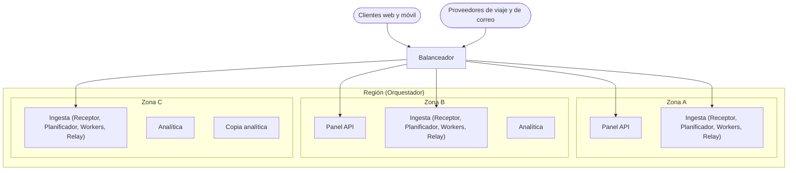
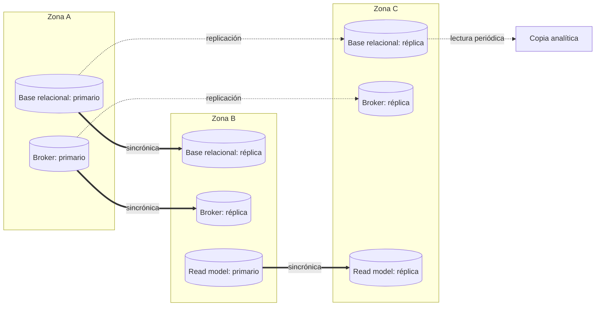
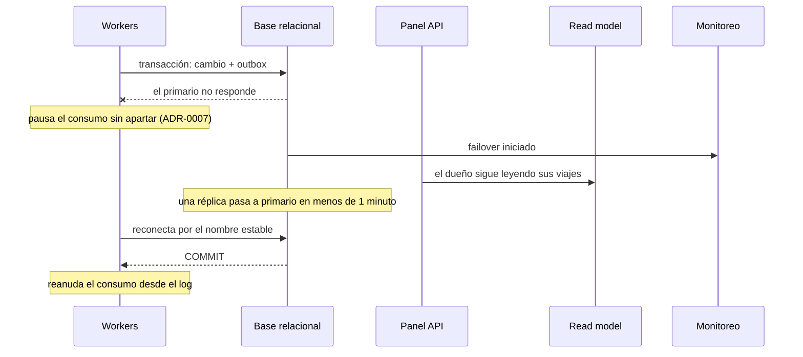

# Iteración 5 de Trotamundos: despliegue en producción

- Estado: Borrador para revisión
- Fecha: 27/10/2026

---

## Paso 1. Revisar las entradas del diseño

### 1.1 Contexto

Trotamundos unifica los arreglos de viaje en un panel (CU-01). Las iteraciones anteriores fijaron la estructura general (ADR-0001 a ADR-0004), la ingesta de proveedores de viaje (ADR-0005 a ADR-0007), el pipeline de correo (ADR-0008 a ADR-0010) y el contrato externo del Panel API (ADR-0011 a ADR-0013). Ningún elemento tiene todavía una asignación a infraestructura: la base relacional, el read model y el broker son instancias únicas, y la copia hacia el almacén analítico no tiene responsable. Es la última iteración. Cierra el diseño definiendo el despliegue en ADR-0014 y ADR-0015 y deja registrada la deuda conocida.

### 1.2 Entradas

| Not Yet Addressed | Partially Addressed | Completely Addressed |
|---|---|---|
| CU-05, CU-07, CU-09, R-5, CRN-8, CRN-10, CRN-11, CRN-12, CRN-13, CRN-14, CRN-15, CRN-16 | CU-01, CU-02, CU-03, CU-08, QA-1, QA-3, QA-4, QA-5, QA-6, QA-7, QA-8, QA-9, QA-10, QA-12, R-1, R-3, R-4, R-6, CRN-2, CRN-3, CRN-4, CRN-5, CRN-6, CRN-9 | CRN-1, R-2, CU-04, CU-06, QA-2, QA-11, CRN-7 |

Drivers nuevos desde la iteración anterior: ninguno.

---

## Paso 2. Establecer el objetivo de la iteración seleccionando drivers

**Objetivo:** Al cerrar la iteración, Trotamundos tiene definido su despliegue en producción, de modo que QA-4 queda abordado por análisis, el modo degradado del panel (CRN-14) queda acotado a la duración de un failover y la copia hacia el almacén analítico tiene un responsable (CRN-8).

**Tipo:** Drivers relacionados (CU + QA)

| Driver | Motivo por el que condiciona las decisiones |
|---|---|
| QA-4* | Tolerar la caída de una instancia o de una zona con ≤ 5 min mensuales de inactividad (≈ 99,99 %) |
| CRN-14* | Con la base relacional caída, el panel queda degradado |
| CRN-8* | La copia hacia el almacén analítico no tiene elemento responsable |
| CRN-6 | El broker está en el camino de entrada y no debe perder lo confirmado |
| CRN-3 | La analítica debe seguir aislada del sistema operativo |
| QA-1 | La confirmación entre zonas y el escalado consumen parte de los 5 min |
| QA-6 | El Panel API debe escalar ante picos ×10 |
| QA-7 | Los workers deben crecer con las 15 M de cuentas de correo |
| R-4 | Varias regiones obligan a decidir qué datos personales cruzan de región |
| R-6 | El despliegue debe ser operable en un plazo acotado |
| CU-01, CU-02, CU-03, CU-05 | Los flujos que el despliegue debe mantener disponibles, y la copia analítica |

---

## Paso 3. Elegir uno o más elementos del sistema para refinar

- **Elementos seleccionados:** Todos los desplegables (Panel API, roles de la Ingesta y Analítica) y los almacenes (Base relacional, Read model y Broker con log persistente), en su asignación a infraestructura.
- **Tipo de refinamiento:** Mejora
- **Límite y fuera de alcance:** Se asignan desplegables y almacenes a zonas y a una plataforma de ejecución, y se asigna la copia analítica. Quedan fuera, como deuda conocida (7.3), el despliegue en varias regiones, la verificación bajo carga y los clientes. QA-5 y CRN-9 se tocan sin ser objetivo.

---

## Paso 4. Elegir conceptos de diseño y registrar las decisiones

### 4.1 Decisiones

| Decisión | Tipo | Drivers | ADR | Descartadas | Justificación (solo si es menor) |
|---|---|---|---|---|---|
| Una región con tres zonas, almacenes con réplica sincrónica y failover automático en menos de 1 minuto | Táctica | QA-4, QA-1, QA-5, R-4, R-6, CRN-6, CRN-9, CRN-14 | ADR-0014 | Una sola zona, Réplicas asincrónicas, Dos regiones activa y pasiva | — |
| Contenedores en un orquestador gestionado, con los almacenes como servicios gestionados | Componente externo | QA-4, QA-6, QA-7, QA-1, R-6, CRN-3, CRN-6 | ADR-0015 | Máquinas virtuales, Funciones sin servidor, Orquestador propio | — |
| Copia analítica como tarea periódica que lee de una réplica de la base relacional | Táctica | CRN-3, CRN-8, CU-05 | menor | Sin alternativas registradas | La réplica ya existe por el ADR-0014 y la copia no toca el primario ni da acceso a la Analítica a la base operacional. |
| Prototipo en docker-compose con las mismas imágenes de contenedor | Tecnología | R-6 | menor | Sin alternativas registradas | El equipo prueba el mismo artefacto que va a producción sin operar el orquestador durante el desarrollo. |
| Alertas consolidadas: retraso de consumo, antigüedad del outbox, salto de apartados, memoria del broker y cada failover | Táctica | QA-4, QA-1, CRN-4 | menor | Sin alternativas registradas | Son las alertas que ya piden las mitigaciones de los ADR, reunidas en un solo lugar. |

### 4.2 Cómo se combinan

El ADR-0014 exige réplicas y failover entre zonas, y el ADR-0015 los obtiene de servicios gestionados y reparte las instancias entre esas zonas. La copia analítica aprovecha una de esas réplicas. El costo conjunto es una dependencia del proveedor de nube para cumplir QA-4, y una latencia que suman la confirmación entre zonas y el escalado por retraso contra los 5 min de QA-1. Lo primero se recoge en CRN-18 y lo segundo, en CRN-4.

---

## Paso 5. Instanciar elementos, asignar responsabilidades y definir interfaces

Los elementos de las iteraciones anteriores que no figuran no cambian.

| Elemento | Responsabilidad (una frase) | Tecnología | Se comunica con (mecanismo) |
|---|---|---|---|
| Balanceador | Reparte los pedidos de los clientes y los avisos de los proveedores entre las instancias de las zonas. | Servicio del proveedor de nube | Clientes web y móvil y Proveedores (HTTP); Panel API y Receptor (HTTP) |
| Orquestador | Ejecuta cada despliegue con al menos dos instancias en zonas distintas y reemplaza las caídas. | Orquestador de contenedores gestionado | Todos los desplegables |
| Panel API | Escala por la carga de pedidos. | Contenedor | Balanceador (HTTP) |
| Workers | Escalan por el retraso de consumo de su stream. | Contenedor | Broker con log persistente (mensajes) |
| Receptor, Planificador de sondeo y Relay | Corren con escalado propio; el planificador no duplica sondeos porque hay un trabajo pendiente por cuenta (ADR-0010). | Contenedor | Sin cambios |
| Analítica | Corre en su propio despliegue, sin acceso a la base operacional. | Contenedor | Almacén analítico |
| Copia analítica | Copia periódicamente los registros de una réplica de la base relacional al almacén analítico. | Contenedor (tarea periódica) | Base relacional, réplica (SQL); Almacén analítico |
| Base relacional y Read model | Tienen un primario y dos réplicas en zonas distintas, con confirmación sincrónica en una y failover en menos de 1 minuto. | PostgreSQL, servicio gestionado | Sin cambios |
| Broker con log persistente | Tiene un primario y réplicas en otras zonas, con failover automático. | Redis Streams, servicio gestionado | Sin cambios |
| Monitoreo | Concentra las alertas y avisa ante cada failover. | Servicio del proveedor de nube | Todos los desplegables y almacenes |

**Interfaces:**

- Desplegables → almacenes · conexión al primario: por un nombre estable que, tras el failover, apunta al nuevo primario sin redespliegue.
- Copia analítica → Base relacional · lectura periódica: solo sobre una réplica, nunca sobre el primario.

---

## Paso 6. Esbozar vistas

**Vista: Desplegables por zona**

- Tipo de vista: Asignación
- Qué muestra: Cómo se reparten las instancias de los desplegables entre las tres zonas.

Diagrama:

Clave:

- Óvalo: actor externo. Rectángulo: instancia de un desplegable.
- Recuadro exterior: región gestionada por el Orquestador. Recuadro interior: zona.
- Flecha: pedido HTTP repartido por el Balanceador. El reparto es ilustrativo: el Orquestador mantiene al menos dos zonas por despliegue.

**Vista: Almacenes por zona**

- Tipo de vista: Asignación
- Qué muestra: Dónde están el primario y las réplicas de cada almacén y cuál confirma de forma sincrónica.

Diagrama:

Clave:

- Cilindro: instancia de un almacén. Rectángulo: desplegable. Recuadro: zona.
- Flecha gruesa: confirmación sincrónica antes de responder. Flecha punteada: replicación o lectura sin esperar confirmación.
- Basta con que una de las dos réplicas confirme; la ubicación de los primarios es ilustrativa.

**Vista: Failover de la base relacional**

- Tipo de vista: Secuencia
- Qué muestra: Qué pasa con la ingesta y el panel cuando cae la zona del primario.

Diagrama:

Clave:

- Columna: elemento del Paso 5. Flecha sólida: llamada. Flecha punteada: respuesta. Flecha con cruz: llamada fallida. Nota: cambio de estado.

---

## Paso 7. Analizar el diseño y revisar el objetivo y el propósito del diseño

### 7.1 Concerns nuevas

| ID | Concern | Riesgos de origen | Mitigación prevista |
|---|---|---|---|
| CRN-17 | La caída de toda la región deja el sistema fuera de servicio, y extenderlo a otra región exige resolver la protección de datos por región | TP-3 | Se acepta; evolución a dos regiones, activa y pasiva (ADR-0014) |
| CRN-18 | El margen mensual de QA-4 y las garantías del broker dependen de los servicios gestionados del proveedor de nube | TP-4, PL-1, PL-3 | Alertas por failover y prueba periódica de caída de zona; verificar la configuración del broker antes de elegir el servicio; almacenes estándar sin extensiones propias |

Los IDs son provisionales y continúan el catálogo (último: CRN-16).

**Riesgos que se suman a drivers existentes:**

| Driver | Riesgos |
|---|---|
| CRN-4 | TP-1 (latencia de la confirmación sincrónica), PL-2 (escalado tardío ante un pico) |

TP-2 queda resuelto con dos réplicas por almacén.

### 7.2 Kanban al cierre

| Not Yet Addressed | Partially Addressed | Completely Addressed |
|---|---|---|
| CU-07, CU-09, R-5, CRN-10, CRN-11, CRN-12, CRN-13, CRN-15, CRN-16, CRN-17, CRN-18 | CU-01, CU-02, CU-03, CU-05, CU-08, QA-1, QA-3, QA-5, QA-6, QA-7, QA-8, QA-9, QA-10, QA-12, R-1, R-3, R-4, R-6, CRN-2, CRN-3, CRN-4, CRN-5, CRN-6, CRN-9 | CRN-1, R-2, CU-04, CU-06, QA-2, QA-4, QA-11, CRN-7, CRN-8, CRN-14 |

### 7.3 Evaluación y resultado

- **¿Se alcanzó el objetivo del Paso 2?** Sí. El despliegue quedó definido (ADR-0014, ADR-0015, decisiones menores y vistas de asignación). QA-4, CRN-14 y CRN-8 quedan abordados.

| Driver | Cambio | Evidencia | Falta |
|---|---|---|---|
| QA-4 | Parcial → Abordado | Análisis: cada desplegable corre en al menos dos zonas y se reemplaza solo, y cada almacén hace failover en menos de 1 minuto (ADR-0014, ADR-0015). La caída de una zona consume menos de 1 de los 5 min mensuales. | — |
| CRN-14 | No abordado → Abordado | El modo degradado dura lo que el failover de la base, menos de 1 minuto (vista de failover). | — |
| CRN-8 | No abordado → Abordado | La Copia analítica es el elemento responsable y lee de una réplica (decisión menor). | — |
| CU-05 | No abordado → Parcial | La Analítica corre en su propio despliegue y se alimenta por la Copia analítica. | Tecnología del almacén analítico |
| CRN-17, CRN-18 | Nuevo → No abordado | Concerns nuevas de esta iteración. | Mitigaciones del 7.1 |

- **Resultado:** Trotamundos queda desplegado en una región con tres zonas, sobre un orquestador gestionado y con almacenes gestionados que replican entre zonas y hacen failover en menos de 1 minuto (ADR-0014, ADR-0015). Con esto cierra el proceso de diseño: los drivers de prioridad Alta tienen camino de cumplimiento, y QA-2, QA-4 y QA-11 quedan abordados por análisis.
- **Deuda conocida al cierre:** se deja a propósito, porque el diseño alcanza para el prototipo (R-6).

| Tema | Drivers | Qué falta |
|---|---|---|
| Verificación bajo carga y con proveedores simulados | QA-1, QA-5, QA-6, QA-7, QA-8, QA-9, QA-10, QA-12, CRN-4 | Prueba de carga con picos ×10 y proveedores de viaje y de correo simulados |
| Clientes web y móvil | QA-3, R-1, R-5 | Entrega del cliente y presupuesto del primer despliegue |
| Varias regiones | R-4, CRN-17 | Protección de datos por región y segunda región |
| Funcionalidad secundaria | CU-07, CU-09 | Agrupación de reservas por viaje y resolución con la agencia |
| Concerns de iteraciones anteriores | CRN-10, CRN-11, CRN-12, CRN-13, CRN-15, CRN-16, CRN-18 | Las mitigaciones registradas en cada iteración |
