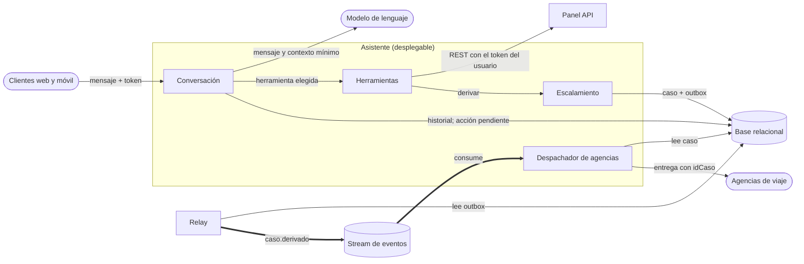

# Iteración 6 de Trotamundos: asistente virtual de primer nivel con derivación a la agencia

- Estado: Borrador para revisión
- Fecha: 21/11/2026

---

## Paso 1. Revisar las entradas del diseño

### 1.1 Contexto

Trotamundos unifica los arreglos de viaje en un panel (CU-01). Las iteraciones 1 a 5 cerraron la estructura (ADR-0001 a 0004), la ingesta de proveedores y de correo (ADR-0005 a 0010), el contrato del Panel API (ADR-0011 a 0013) y el despliegue en una región con tres zonas (ADR-0014, 0015). La Opción B de la consigna suma un asistente conversacional de primer nivel: consulta el estado, reprograma y resuelve problemas menores, y deriva a la agencia preferida del usuario solo los casos complejos. Esta iteración lo define en ADR-0016 a ADR-0018. No reemplaza ningún ADR: extiende el ADR-0001 (cuarto desplegable), el ADR-0006 (un tipo de evento nuevo) y el ADR-0011 (un segundo contrato externo, `/v1/asistente`).

### 1.2 Entradas

| Not Yet Addressed | Partially Addressed | Completely Addressed |
|---|---|---|
| CU-07, CU-09, R-5, CRN-10, CRN-11, CRN-12, CRN-13, CRN-15, CRN-16, CRN-17, CRN-18 | CU-01, CU-02, CU-03, CU-05, CU-08, QA-1, QA-3, QA-5, QA-6, QA-7, QA-8, QA-9, QA-10, QA-12, R-1, R-3, R-4, R-6, CRN-2, CRN-3, CRN-4, CRN-5, CRN-6, CRN-9 | CRN-1, R-2, CU-04, CU-06, QA-2, QA-4, QA-11, CRN-7, CRN-8, CRN-14 |

Drivers nuevos desde la iteración anterior, que salen de la consigna (propuestos†, a incorporar al catálogo):

- **CU-10:** el viajero consulta el estado, reprograma o resuelve un problema menor por chat, y los casos complejos se derivan a su agencia preferida.
- **QA-13†:** el asistente responde por primera vez en < 5 s con carga normal, sin degradar el panel.
- **QA-14†:** el asistente no ve ni hace más que el usuario: 0 accesos fuera de sus permisos y 0 escrituras sin confirmación explícita.

† Medida propuesta por el equipo.

---

## Paso 2. Establecer el objetivo de la iteración seleccionando drivers

**Objetivo:** Al cerrar la iteración, el asistente (CU-10) tiene definido dónde corre, cómo interpreta al usuario sin salirse de los permisos y contratos existentes y cómo deriva los casos complejos a la agencia (CU-09), con QA-14 abordado por análisis y QA-13 medible con un modelo de lenguaje y agencias simulados.

**Tipo:** Drivers relacionados (CU + QA)

| Driver | Motivo por el que condiciona las decisiones |
|---|---|
| CU-10* | Es la capacidad que la iteración define |
| QA-14* | El asistente actúa con la identidad del usuario: pide un único camino de acceso y confirmación previa a toda escritura |
| QA-13* | Las llamadas al modelo duran segundos: pide aislar al asistente del panel |
| CU-09 | La derivación a la agencia es el caso complejo del asistente |
| CU-04 | Reprogramar y corregir usan la gestión manual y el origen único de escritura (ADR-0013) |
| QA-11 | Ninguna ruta de itinerario existe fuera del punto de autorización (ADR-0012) |
| QA-4 | La caída del modelo o de una agencia no debe afectar al panel |
| QA-6 | Las llamadas lentas y costosas al modelo no deben arrastrar a las lecturas del panel |
| R-4 | El itinerario es dato personal y viajaría a un modelo externo y a las agencias |
| CRN-9 | Una confirmación o una entrega repetida no debe duplicar efectos |
| R-6, CRN-2 | Plazo acotado y conocimiento del equipo limitan piezas y tecnologías |

---

## Paso 3. Elegir uno o más elementos del sistema para refinar

- **Elementos seleccionados:** Un desplegable nuevo (Asistente) y su relación con el Panel API, la Base relacional, el Relay y el Stream de eventos.
- **Tipo de refinamiento:** Mejora (se suma un desplegable sin modificar los existentes).
- **Límite y fuera de alcance:** El Panel API y la Ingesta no cambian. Quedan fuera la escritura hacia los proveedores de viaje (R-2), el canal de respuesta de la agencia y la resolución del caso (CU-09), el cliente del chat en web y móvil (R-1, R-5) y la calidad del modelo. QA-1 y CRN-5 se tocan sin ser objetivo.

---

## Paso 4. Elegir conceptos de diseño y registrar las decisiones

### 4.1 Decisiones

| Decisión | Tipo | Drivers | ADR | Descartadas | Justificación (solo si es menor) |
|---|---|---|---|---|---|
| Asistente como cuarto desplegable que opera por la API del Panel API con el token del usuario | Patrón | CU-10, QA-11, QA-13, QA-14, QA-4, QA-6, R-6, CRN-2 | [ADR-0016](<ADRS/iteracion_6/ADR-0016__Asistente_como_cuarto_desplegable_sobre_la_API.md>) | Módulo dentro del Panel API, Acceso directo a los almacenes, Plataforma de chatbot de terceros | — |
| Modelo de lenguaje limitado a un catálogo cerrado de herramientas, con confirmación previa a toda escritura y escalamiento por reglas | Táctica | CU-10, CU-04, CU-09, QA-14, QA-13, QA-4, R-4, R-6 | [ADR-0017](<ADRS/iteracion_6/ADR-0017__Modelo_de_lenguaje_con_herramientas_cerradas_y_confirmacion.md>) | Árbol de reglas sin modelo, NLU entrenado, Agente con acceso libre a la API | — |
| Derivación como caso registrado con outbox y despachador por agencia | Patrón | CU-10, CU-09, QA-4, CRN-9, R-4, R-6 | [ADR-0018](<ADRS/iteracion_6/ADR-0018__Derivacion_a_la_agencia_con_outbox_y_despachador.md>) | Entrega sincrónica, Solo mostrar el contacto, Correo directo sin caso | — |
| Modelo de lenguaje por API de un proveedor | Componente externo | CU-10, R-6 | menor | Sin alternativas registradas | Alojar un modelo propio excede el plazo (R-6); queda detrás de un puerto. |
| Java como lenguaje del Asistente | Tecnología | CRN-2 | menor | Sin alternativas registradas | Es el lenguaje del equipo y comparte bibliotecas con el Panel API. |
| Conversaciones, acciones pendientes y casos en tablas propias de la base relacional, con retención de 30 días† | Táctica | CU-10, R-4, R-6 | menor | Sin alternativas registradas | PostgreSQL ya existe y el Asistente es dueño solo de sus tablas. |
| Límite de mensajes por usuario | Táctica | QA-6, QA-13 | menor | Sin alternativas registradas | Acota las llamadas lentas y costosas al modelo. |
| Catálogo de agencias por configuración | Táctica | CU-09, R-6 | menor | Sin alternativas registradas | Como la whitelist del ADR-0009, las agencias se conocen al desplegar. |
| Prototipo con modelo y agencias simulados en docker-compose | Tecnología | R-6, QA-14 | menor | Sin alternativas registradas | Permite probar QA-14 con respuestas fijas del modelo, como los proveedores simulados. |

### 4.2 Cómo se combinan

El mensaje recorre cliente, Asistente, modelo, herramienta y Panel API, que aplica sus reglas de siempre (ADR-0012, ADR-0013). La derivación reutiliza outbox, Relay y stream de eventos. El costo conjunto es un salto más por acción y la latencia del modelo contra QA-13, más pedidos al Panel API (QA-6) y datos personales hacia terceros (R-4); se recogen en CRN-19 a CRN-22.

---

## Paso 5. Instanciar elementos, asignar responsabilidades y definir interfaces

Los elementos de las iteraciones anteriores que no figuran no cambian.

| Elemento | Responsabilidad (una frase) | Tecnología | Se comunica con (mecanismo) |
|---|---|---|---|
| Asistente | Atiende la conversación del usuario y ejecuta sus acciones confirmadas por la API del Panel API. | Java | Clientes web y móvil (HTTP); Panel API (REST con el token del usuario); Modelo de lenguaje (HTTPS); Base relacional (SQL) |
| Conversación | Guarda el historial y la acción pendiente, y pide al modelo la herramienta que corresponde. | Java (en el Asistente) | Modelo de lenguaje (HTTPS); Herramientas; Base relacional (SQL) |
| Herramientas | Catálogo cerrado de cinco operaciones (consultar viajes, consultar viaje, modificar reserva, desvincular reserva, derivar a la agencia) que se ejecutan con el token del usuario. | Java (en el Asistente) | Panel API (REST); Escalamiento |
| Escalamiento | Decide por reglas fijas si un caso es complejo y lo registra junto con su evento. | Java (en el Asistente) | Base relacional (SQL) |
| Despachador de agencias | Consume los eventos de caso derivado y los entrega a la agencia preferida, con circuit breaker por agencia. | Java (en el Asistente) | Stream de eventos (mensajes); Base relacional (SQL); Agencias de viaje (HTTP) |
| Modelo de lenguaje | Interpreta cada mensaje y devuelve la herramienta y sus parámetros, sin ejecutar nada. | API de un proveedor (PENDIENTE: proveedor y modelo) | Asistente (HTTPS) |
| Agencias de viaje | Reciben los casos complejos por el canal de su configuración. | — (externo; simuladas en el prototipo) | Despachador de agencias |
| Base relacional | Guarda además conversaciones, acciones pendientes, casos y la agencia preferida de cada usuario. | PostgreSQL | Panel API, Workers, Relay y Asistente |
| Relay | Publica también los eventos de caso del outbox. | Como Ingesta | Base relacional (SQL); Stream de eventos (mensajes) |
| Balanceador | Enruta `/v1/asistente` al Asistente, con al menos dos instancias en zonas distintas (ADR-0014). | Servicio del proveedor de nube | Asistente (HTTP) |

**Interfaces:**

- Asistente · `POST /v1/asistente/mensajes`: token y texto → respuesta, y si hay una escritura, su resumen con los valores finales y un `idAccion`; 401 sin token válido; 429 sobre el límite; sin modelo responde un menú fijo.
- Asistente · `POST /v1/asistente/acciones/{idAccion}/confirmacion`: token → resultado de la acción; vence a los 10 min†; si la versión del viaje cambió, 409 con una propuesta nueva; idempotente por `idAccion`.
- Asistente · `PUT /v1/asistente/agencia`: agencia del catálogo → preferencia guardada; 422 si no está en el catálogo.
- Herramientas → Panel API: solo los recursos de la Iteración 4 (`GET /v1/viajes`, `GET /v1/viajes/{id}`, `PUT /v1/reservas/{id}`, `POST /v1/reservas/{id}/desvinculacion`); 403, 409 y 422 se informan al usuario sin reintento.
- Escalamiento → Base relacional · derivar: caso y evento `caso.derivado` en una transacción; el evento usa el sobre del ADR-0006 con `claveDeOrden` `viaje:<id>` e `idViaje`, sin contenido del caso.
- Despachador → Agencia · entregar caso: `idCaso` como clave de idempotencia; 2xx = entregado.
- Pendientes: contrato real con las agencias y respuesta de resolución (CU-09), cliente del chat (R-1, R-5). No tienen iteración prevista: quedan como deuda (7.3).

---

## Paso 6. Esbozar vistas

**Vista: Asistente y su entorno**

- Tipo de vista: Component & Connector
- Qué muestra: Los roles del Asistente y cómo se apoya en el Panel API, el modelo, la base y el stream de eventos.

Diagrama:



Clave:

- Óvalo: actor externo. Rectángulo: elemento de software. Cilindro: almacén o stream del log.
- Recuadro con título: desplegable.
- Flecha fina: llamada o acceso directo. Flecha gruesa: mensaje asíncrono por el broker.

**Vista: Reprogramar una reserva con confirmación**

- Tipo de vista: Secuencia
- Qué muestra: Que ninguna escritura ocurre sin confirmación y que una reserva de proveedor no se edita (ADR-0013), de donde salen las interfaces de mensajes y confirmación.

Diagrama:

```mermaid
sequenceDiagram
  participant C as Clientes web y móvil
  participant A as Asistente
  participant M as Modelo de lenguaje
  participant P as Panel API
  participant B as Base relacional

  C->>A: mensaje + token
  A->>M: mensaje y contexto mínimo
  M-->>A: herramienta modificar_reserva y parámetros
  A->>P: GET /v1/viajes/{id} con el token del usuario
  P-->>A: viaje y versión
  alt reserva manual o desvinculada
    A->>B: guardar acción pendiente
    A-->>C: propuesta con los valores finales
    C->>A: confirmación de idAccion
    A->>P: PUT /v1/reservas/{id}
    P-->>A: 200
    A-->>C: reserva actualizada
  else reserva de proveedor
    A-->>C: no se edita aquí; ofrece derivar a la agencia
  end
```

Clave:

- Columna: elemento del Paso 5. Flecha sólida: llamada. Flecha punteada: respuesta.
- `alt`: caminos excluyentes. Un 403 o 422 del Panel API se informa al usuario (no se muestra).

**Vista: Derivación a la agencia**

- Tipo de vista: Secuencia
- Qué muestra: Cómo un caso confirmado llega a la agencia sin perderse ni duplicarse, de donde salen las interfaces de derivación.

Diagrama:

```mermaid
sequenceDiagram
  participant C as Clientes web y móvil
  participant A as Asistente
  participant B as Base relacional
  participant R as Relay
  participant S as Stream de eventos
  participant D as Despachador de agencias
  participant G as Agencias de viaje

  C->>A: confirmación de derivar
  A->>B: transacción: caso + evento caso.derivado
  A-->>C: caso registrado, derivando
  R->>B: leer outbox pendiente
  R-)S: publicar evento
  S-)D: entregar evento
  D->>B: leer caso y agencia preferida
  D->>G: entregar caso con idCaso
  alt la agencia responde 2xx
    G-->>D: recibido
    D->>B: estado derivado
    D->>S: confirmar
  else la agencia falla
    G--xD: error o sin respuesta
    Note over D: abre el circuito de esa agencia; el evento espera en el log (ADR-0007)
  end
```

Clave:

- Columna: elemento del Paso 5. Flecha sólida: llamada. Flecha punteada: respuesta. Flecha con cruz: llamada fallida. Flecha abierta: entrega asíncrona por el broker. Nota: acción interna.
- `alt`: caminos excluyentes.

---

## Paso 7. Analizar el diseño y revisar el objetivo y el propósito del diseño

### 7.1 Concerns nuevas

| ID | Concern | Riesgos de origen | Mitigación prevista |
|---|---|---|---|
| CRN-19 | El asistente opera con la identidad del usuario sobre texto libre: el modelo puede elegir mal o ser manipulado por el texto de una reserva | AS-4, LM-1, LM-2 | Catálogo cerrado, confirmación con valores armados por el código y pruebas con modelo simulado (ADR-0017) |
| CRN-20 | La latencia, el costo y la disponibilidad del modelo externo condicionan QA-13 | AS-1, LM-4, LM-5 | Límite de mensajes, espera acotada, menú fijo y prueba de carga (CRN-4) |
| CRN-21 | Los datos personales del itinerario llegan a un modelo externo y a las agencias | LM-3, DA-5 | Contexto mínimo, confirmación antes de derivar y condiciones del proveedor del modelo (PENDIENTE) |
| CRN-22 | La derivación depende de agencias aún no definidas: canal, idempotencia y resolución | DA-1, DA-4 | Agencias simuladas; contrato y resolución quedan como deuda (CU-09) |

Los IDs son provisionales y continúan el catálogo (último: CRN-18).

**Riesgos que se suman a drivers existentes:**

| Driver | Riesgos |
|---|---|
| CRN-14 | AS-5 (con la base caída el asistente no guarda historial ni acepta acciones) |
| CRN-5 | DA-2 (el Asistente escribe en el outbox compartido), DA-3 (eventos de caso en el stream de eventos) |
| QA-6 | AS-1 (un pedido más al Panel API por acción) |

AS-2 y AS-3 (costo operativo del cuarto desplegable y dos contratos externos) se aceptan en el ADR-0016.

### 7.2 Kanban al cierre

| Not Yet Addressed | Partially Addressed | Completely Addressed |
|---|---|---|
| CU-07, R-5, CRN-10, CRN-11, CRN-12, CRN-13, CRN-15, CRN-16, CRN-17, CRN-18, CRN-19, CRN-20, CRN-21, CRN-22 | CU-01, CU-02, CU-03, CU-05, CU-08, CU-09, CU-10, QA-1, QA-3, QA-5, QA-6, QA-7, QA-8, QA-9, QA-10, QA-12, QA-13, R-1, R-3, R-4, R-6, CRN-2, CRN-3, CRN-4, CRN-5, CRN-6, CRN-9 | CRN-1, R-2, CU-04, CU-06, QA-2, QA-4, QA-11, QA-14, CRN-7, CRN-8, CRN-14 |

### 7.3 Evaluación y resultado

- **¿Se alcanzó el objetivo del Paso 2?** Sí. El asistente quedó definido (ADR-0016 a 0018, decisiones menores, Paso 5 y vistas) sin cambiar el Panel API ni la Ingesta.

| Driver | Cambio | Evidencia | Falta |
|---|---|---|---|
| QA-14 | Nuevo → Abordado | Análisis por construcción: el Asistente no tiene credenciales propias, todo acceso pasa por el Panel API con el token del usuario (ADR-0012, ADR-0013) y toda escritura se ejecuta solo desde el endpoint de confirmación (ADR-0016, ADR-0017). | — |
| CU-10 | Nuevo → Parcial | Consulta, modificación y derivación definidas con interfaces del Paso 5. | Reprogramar con el proveedor (R-2) y cliente del chat |
| QA-13 | Nuevo → Parcial | Asistente aislado del panel, con escalado propio y límite de mensajes (ADR-0016). | Medir los 5 s con el modelo real |
| CU-09 | No abordado → Parcial | Caso registrado y entregado a la agencia sin pérdidas (ADR-0018). | Contrato con agencias y resolución |
| CRN-19 a CRN-22 | Nuevo → No abordado | Concerns nuevas de esta iteración. | Mitigaciones del 7.1 |

- **Resultado:** Trotamundos suma un cuarto desplegable, el Asistente, que opera solo por la API del Panel API con el token del usuario (ADR-0016). Un modelo de lenguaje elige entre cinco herramientas cerradas, toda escritura exige confirmación y el escalamiento lo deciden reglas fijas (ADR-0017). Los casos complejos se registran con outbox y se entregan a la agencia preferida por un despachador (ADR-0018).
- **Deuda conocida:**

| Tema | Drivers | Qué falta |
|---|---|---|
| Reprogramar en el proveedor | CU-10, R-2 | Un canal de escritura hacia los proveedores; hoy el cambio real es un caso para la agencia |
| Agencias y resolución | CU-09, CRN-22 | Contrato con las agencias y retorno de la resolución al usuario |
| Cliente del chat | CU-10, R-1, R-5 | Interfaz en web y móvil |
| Verificación con el modelo real | QA-13, CRN-20 | Prueba de latencia y de carga |
