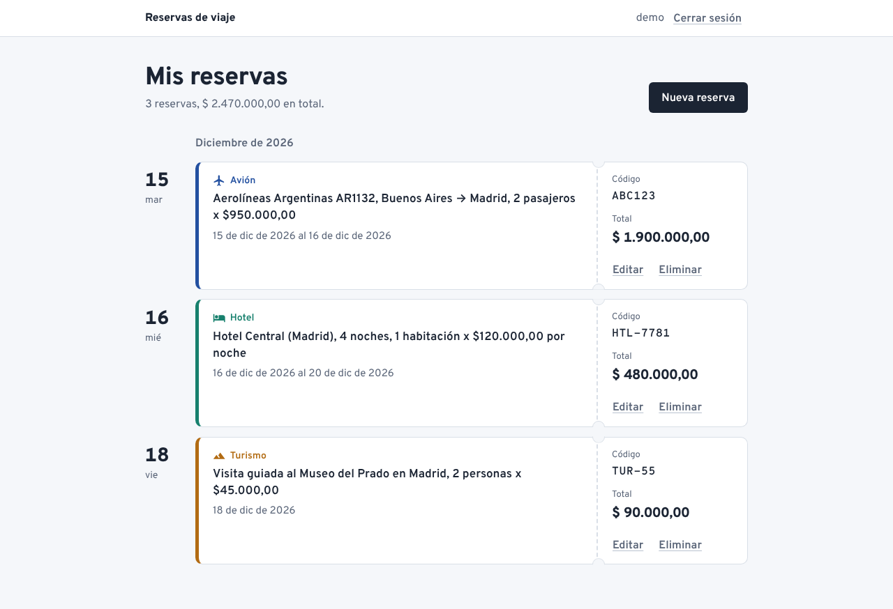

# Sistema de reservas

Diseño chico en Java de un sistema de reservas de **avión**, **hotel** y **turismo**. Cada **usuario** tiene contraseña y gestiona solo sus propias reservas (alta, modificación y baja) desde dos interfaces que comparten el mismo dominio:

- **Web**: una página que se abre en el navegador, servida por un servidor HTTP escrito en Java.
- **Consola**: el menú de texto original.

En el TPE corresponde a **CU-04: Gestión manual de reservas**, y sigue la misma idea que el ADR-0005: un núcleo común para toda reserva y un detalle propio para cada tipo.



## Cómo ejecutar

Requiere Java (JDK) 8 o superior. No usa librerías externas: el servidor web es el que trae el JDK (`com.sun.net.httpserver`).

### Con doble clic

Descomprimir el zip y hacer doble clic en:

- **Windows:** `iniciar-windows.bat`
- **Mac:** `iniciar-mac.command` (en Linux: `bash iniciar-mac.command` desde una terminal)

Se abre una ventana que compila el proyecto, inicia el servidor y abre el sistema en el navegador. Para detenerlo, se cierra esa ventana. Si no hay Java instalado, el script lo avisa y abre la página de descarga.

La primera vez el sistema operativo puede pedir confirmación porque el archivo viene de internet:
- **Windows:** si aparece "Windows protegió su PC", elegir "Más información" → "Ejecutar de todas formas" (o "Ejecutar", si es una advertencia de seguridad).
- **Mac:** si dice que no se puede abrir porque es de un desarrollador no identificado, ir a Configuración del Sistema → Privacidad y seguridad → "Abrir igualmente". Otra opción es abrir la Terminal, escribir `bash ` y arrastrar el archivo a la ventana.

### Desde la terminal

Desde la carpeta del proyecto:

```bash
# Compilar (las dos interfaces)
javac -encoding UTF-8 -d out src/reservas/*.java src/reservas/web/*.java

# Interfaz web: después abrir http://localhost:8080
java -cp out reservas.web.ServidorWeb

# Interfaz de consola
java -cp out reservas.Main
```

Usuario de prueba con tres reservas cargadas: **demo / demo123**.

- El servidor abre el navegador solo. Si el puerto 8080 está ocupado, usa el siguiente libre (8081, 8082...) y lo informa. También se puede elegir: `java -cp out reservas.web.ServidorWeb 9000`, o `--sin-navegador` para que no lo abra.
- El servidor busca la página en la carpeta `web/`, así que hay que ejecutarlo **desde la carpeta del proyecto**. En IntelliJ o Eclipse: marcar `src` como carpeta de fuentes, ejecutar `reservas.web.ServidorWeb` y dejar como *working directory* la carpeta del proyecto.
- Los datos están en memoria: al detener el servidor se pierden los usuarios y reservas nuevos.
- La tipografía (Overpass) se descarga de Google Fonts. Sin internet la página funciona igual, con la tipografía del sistema.

