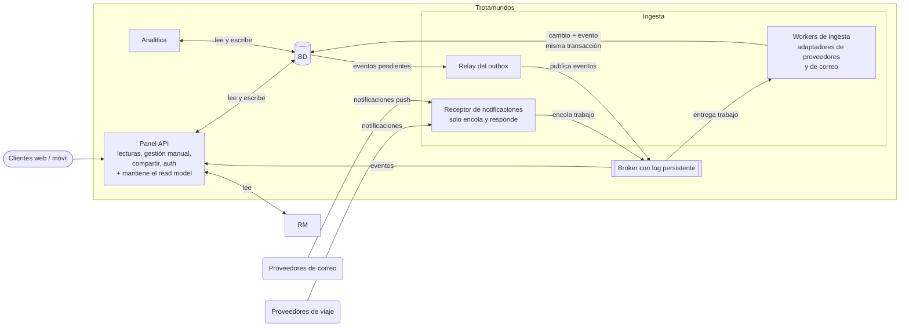

# Vista final de Trotamundos

- **Estado:** Borrador para revisión
- **Fecha:** 19/10/2026
- **Equipo:** grupo TPE
- **Documentos de origen:** ADR-0001 (estilo), ADR-0002 (workers y outbox), ADR-0003 (broker), ADR-0004 (almacén analítico) y ADR-0005 (almacenamiento operacional y read model).

---

## 1. Diagrama

## 2. Cómo leer el diagrama

- Las flechas van de quien **inicia** la comunicación hacia quien responde. Una flecha con doble punta indica que se lee y se escribe.
- Hay **tres desplegables**: Panel API, Ingesta (con tres roles: receptor, workers y relay) y Carga de analítica. El resto son almacenes y el broker.
- Los workers también consultan a los proveedores (detalles de reservas, lectura de correo) con los tokens de la bóveda. Esas llamadas de salida no se dibujaron para no recargar la vista.

## 3. Flujos principales

**Ingesta de una notificación**

1. Un proveedor de viaje o de correo envía una notificación al receptor, que la encola en el stream de trabajo y responde.
2. Un worker toma el trabajo, verifica en la bóveda que el acceso siga vigente, consulta al proveedor o lee el correo, e interpreta el contenido.
3. En **una sola transacción**, el worker guarda el cambio en la BD y escribe el evento en la tabla outbox.
4. El relay lee los eventos pendientes del outbox y los publica en el stream de eventos.

**Actualización del read model**

1. El Panel API recibe el evento, que es un aviso mínimo (viaje X, versión N).
2. Lee el estado actual del viaje en la BD.
3. Reescribe el documento del viaje en el read model, solo si la versión es mayor o igual a la guardada.

**Lectura del panel**

El cliente consulta al Panel API, que lee del read model. Si falta la entrada (primer acceso, expulsión o pérdida), la reconstruye desde la BD y la guarda.

**Cambios manuales del viajero**

El Panel API guarda el cambio en la BD y después actualiza el read model directamente. No pasan por el broker.

**Analítica**

La carga programada copia datos de forma incremental desde la BD al almacén analítico, seudonimizando y excluyendo los campos personales innecesarios. No usa el broker ni el outbox.
